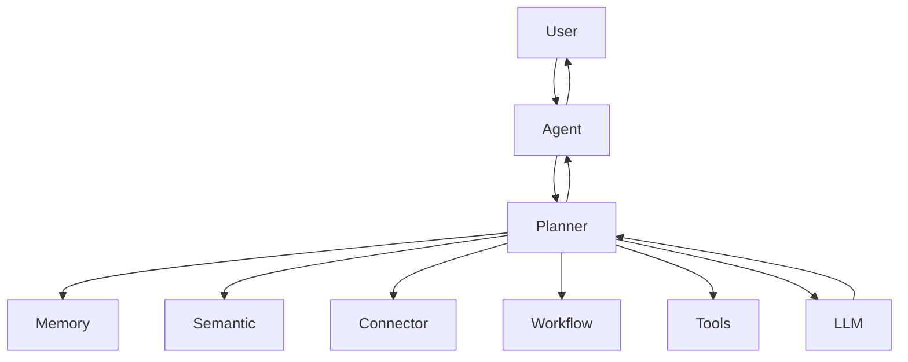
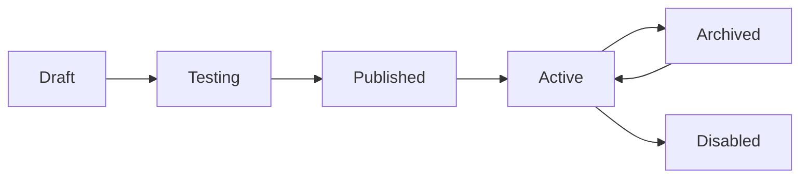
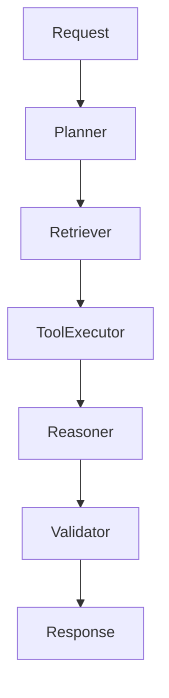
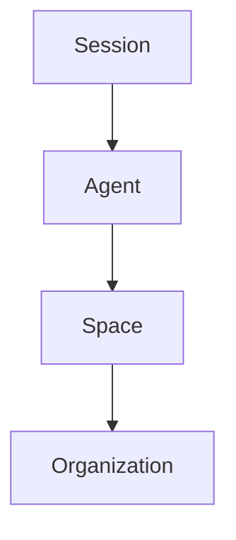
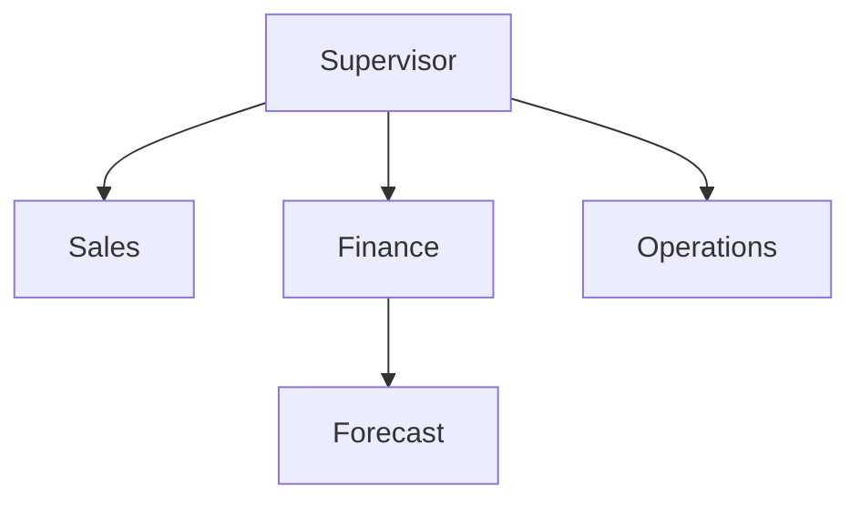

# AGENT_PLATFORM.md

# Agent Platform Specification

---

# Purpose

The Agent Platform is the core of the Business Copilot ecosystem.

Agents represent digital employees capable of:

* Reasoning
* Planning
* Retrieving information
* Executing actions
* Collaborating with humans
* Collaborating with other agents

The objective is to make agents feel like specialized business team members rather than chatbots.

---

# Agent Philosophy

An Agent should be:

* Goal Oriented
* Context Aware
* Data Aware
* Action Capable
* Governed
* Observable
* Shareable

Agents should not merely answer questions.

Agents should complete business objectives.

---

# Core Agent Architecture



---

# Agent Definition

Every agent consists of:

## Identity

* Name
* Description
* Avatar
* Category
* Owner

---

## Objective

Defines the purpose of the agent.

Examples:

* Revenue Analysis
* Forecasting
* Customer Success
* Marketing Attribution
* Supply Chain Monitoring

---

## Instructions

System-level instructions.

Examples:

* Response style
* Decision rules
* Escalation behavior
* Approval requirements

---

## Knowledge

Connected data sources.

Examples:

* Snowflake
* Salesforce
* SharePoint
* PostgreSQL

---

## Memory

Stores context and historical knowledge.

---

## Tools

Available capabilities.

Examples:

* SQL Query Tool
* Search Tool
* Email Tool
* Workflow Tool

---

## Business Rules

Domain-specific logic.

Examples:

Revenue = Sales - Returns

High Risk Customer =
ARR > 100000
AND
Health Score < 70

---

# Agent Types

---

## Conversational Agents

Primary purpose:

Answer questions.

Examples:

* Sales Assistant
* Finance Assistant
* HR Assistant

---

## Analytical Agents

Primary purpose:

Analyze data.

Examples:

* Revenue Analyst
* Marketing Analyst
* Customer Analyst

---

## Monitoring Agents

Primary purpose:

Observe systems.

Examples:

* KPI Monitor
* Revenue Monitor
* SLA Monitor

---

## Automation Agents

Primary purpose:

Execute actions.

Examples:

* Ticket Automation
* Workflow Automation
* Alert Automation

---

## Executive Agents

Primary purpose:

Summarize information.

Examples:

* CEO Copilot
* CFO Copilot
* COO Copilot

---

## Orchestrator Agents

Primary purpose:

Manage other agents.

Examples:

* Supervisor Agent
* Department Coordinator

---

# Agent Lifecycle



---

# Agent Builder

Users should never write prompts directly.

The Agent Builder must provide structured forms.

---

## Step 1

Agent Identity

Fields:

* Name
* Description
* Category

---

## Step 2

Agent Goal

Examples:

* Analyze weekly sales
* Detect anomalies
* Monitor inventory

---

## Step 3

Data Sources

User selects:

* Databases
* Documents
* APIs
* SaaS Systems

---

## Step 4

Business Logic

Rule Builder UI.

Examples:

IF Revenue Drops > 10%

THEN Create Alert

---

## Step 5

Actions

Available actions:

* Send Email
* Create Ticket
* Execute Workflow
* Notify User

---

## Step 6

Guardrails

Examples:

* Require approval
* Limit data access
* Restrict actions

---

## Step 7

Testing

Run simulations.

---

## Step 8

Publish

Make available.

---

# Agent Templates

Templates accelerate adoption.

---

## Sales Analyst

Capabilities:

* Pipeline Analysis
* Deal Tracking
* Forecasting

---

## Finance Analyst

Capabilities:

* Revenue Analysis
* Variance Analysis
* Budget Monitoring

---

## Marketing Analyst

Capabilities:

* Campaign Analysis
* ROI Tracking
* Attribution

---

## Operations Analyst

Capabilities:

* Process Monitoring
* Inventory Analysis
* SLA Monitoring

---

## Customer Success Analyst

Capabilities:

* Churn Detection
* Health Monitoring
* Ticket Analysis

---

# Agent Runtime

The runtime is responsible for execution.

---

# Runtime Architecture



---

# Runtime Responsibilities

## Planning

Break objective into tasks.

---

## Retrieval

Collect context.

---

## Tool Usage

Invoke external tools.

---

## Reasoning

Generate insights.

---

## Validation

Check quality.

---

## Response

Generate final output.

---

# Agent Memory

Agents should have multiple memory layers.

---

## Session Memory

Current conversation.

Retention:

Hours

---

## Agent Memory

Agent-specific knowledge.

Retention:

Long-term

---

## Space Memory

Shared memory within a space.

Retention:

Long-term

---

## Organizational Memory

Shared organizational knowledge.

Retention:

Permanent

---

# Memory Architecture



---

# Agent Sharing

Agents should be reusable assets.

---

## Sharing Modes

### Private

Owner only.

---

### Shared

Specific users.

---

### Team

Workspace users.

---

### Organization

All organization users.

---

### Marketplace

Published catalog.

---

# Agent Permissions

Owner

Admin

Editor

Viewer

Executor

---

# Agent Marketplace

Purpose:

Internal app store.

---

## Features

* Browse Agents
* Search Agents
* Clone Agents
* Install Agents
* Rate Agents
* Review Agents

---

## Certified Agents

Admin-approved agents.

Special badge.

---

# Agent Versioning

Every change creates a version.

---

## Version Metadata

* Version Number
* Author
* Timestamp
* Changelog

---

## Rollback

Users can restore any version.

---

# Multi-Agent System

Some tasks require multiple agents.

---

# Multi-Agent Architecture



---

# Multi-Agent Workflow

Example:

Question:

Why did revenue decline?

---

Supervisor:

Assign Tasks

↓

Sales Agent

Analyze Pipeline

↓

Finance Agent

Analyze Revenue

↓

Operations Agent

Analyze Fulfillment

↓

Supervisor

Combine Results

↓

User

Receive Explanation

---

# Agent Analytics

Track:

* Usage
* Adoption
* Cost
* Performance

---

## Metrics

### Usage Metrics

* Executions
* Active Users
* Conversations

---

### Performance Metrics

* Latency
* Success Rate
* Error Rate

---

### Cost Metrics

* LLM Cost
* Connector Cost
* Storage Cost

---

# Agent Health Score

Calculated from:

* Usage
* Cost
* Reliability
* Satisfaction

---

Formula:

```text
Health Score =
Usage Score
+
Reliability Score
+
Adoption Score
-
Cost Penalty
```

---

# Agent Recommendations

System should recommend:

---

## Archive Agent

If:

* No usage for 90 days

---

## Merge Agent

If:

* Significant overlap

---

## Optimize Agent

If:

* High cost
* Low value

---

# Agent Cost Tracking

Every execution generates cost events.

Track:

* Prompt Tokens
* Completion Tokens
* Embeddings
* Connector Calls
* Workflow Calls

---

# Agent Storage Strategy

Agents should never be deleted by default.

---

## States

Active

Archived

Disabled

Deleted

---

Preferred action:

Archive

Not Delete

---

# Agent Quotas

Quotas should be dynamic.

Track:

* Agent Count
* Memory Size
* Document Size
* Embedding Size

---

Users should effectively have unlimited agents through archival.

---

# Governance

Every agent must support:

* Audit Logs
* Version History
* Approval Workflows
* Access Controls
* Usage Tracking

---

# Security

Agents inherit permissions from:

Organization
→ Workspace
→ Space

Agents cannot access data outside their assigned permissions.

---

# Observability

Every execution must generate:

* Trace ID
* Execution Log
* Cost Event
* Usage Event
* Audit Event

---

# Future Enhancements

* Agent Learning
* Agent-to-Agent Messaging
* Agent Teams
* Agent Certification
* Autonomous Goal Execution
* Agent Knowledge Graph
* Agent Performance Benchmarking

---

# Success Metrics

The Agent Platform is successful when:

* Users create agents without coding
* Agents are reused across teams
* Agent execution is reliable
* Cost is transparent
* Governance is maintained
* Business outcomes improve

The Agent Platform is the primary product capability around which all other platform components are built.
