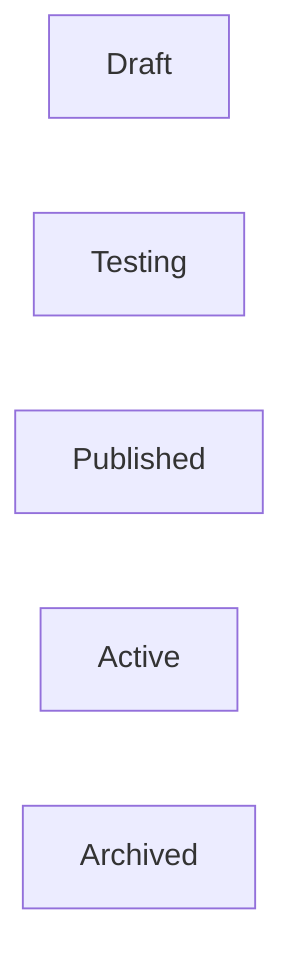

# API_SPEC.md

# Business Copilot Platform API Specification

---

# Purpose

This document defines the API contract for the entire platform.

It serves as the source of truth for:

* FastAPI Implementation
* Frontend Integration
* SDK Development
* Third-Party Integrations
* Testing

All APIs must conform to this specification.

---

# API Standards

## Protocol

HTTPS Only

---

## Format

JSON

---

## Authentication

JWT

OAuth

API Keys

Service Accounts

---

## Versioning

```text
/api/v1
```

Future:

```text
/api/v2
```

---

# Standard Response Format

## Success Response

```json
{
  "success": true,
  "data": {},
  "metadata": {},
  "request_id": "uuid"
}
```

---

## Error Response

```json
{
  "success": false,
  "error": {
    "code": "AGENT_NOT_FOUND",
    "message": "Agent not found"
  },
  "request_id": "uuid"
}
```

---

# Pagination Standard

```json
{
  "page": 1,
  "page_size": 20,
  "total": 120,
  "has_next": true
}
```

---

# Resource Hierarchy

```text
Organization
 └── Workspace
      └── Space
           ├── Agent
           ├── Connector
           ├── Workflow
           ├── Document
           └── Semantic Model
```

---

# Authentication APIs

---

## Login

### POST

```text
/api/v1/auth/login
```

### Request

```json
{
  "email": "user@company.com",
  "password": "******"
}
```

### Response

```json
{
  "access_token": "jwt",
  "refresh_token": "jwt",
  "expires_in": 3600
}
```

---

## Refresh Token

### POST

```text
/api/v1/auth/refresh
```

---

## Logout

### POST

```text
/api/v1/auth/logout
```

---

## Current User

### GET

```text
/api/v1/auth/me
```

---

# Organization APIs

---

## List Organizations

### GET

```text
/api/v1/organizations
```

---

## Create Organization

### POST

```text
/api/v1/organizations
```

---

## Get Organization

### GET

```text
/api/v1/organizations/{id}
```

---

## Update Organization

### PUT

```text
/api/v1/organizations/{id}
```

---

# Workspace APIs

---

## Create Workspace

```text
POST /api/v1/workspaces
```

---

## List Workspaces

```text
GET /api/v1/workspaces
```

---

## Get Workspace

```text
GET /api/v1/workspaces/{id}
```

---

## Archive Workspace

```text
POST /api/v1/workspaces/{id}/archive
```

---

# Space APIs

---

## Create Space

```text
POST /api/v1/spaces
```

---

## List Spaces

```text
GET /api/v1/spaces
```

---

## Get Space

```text
GET /api/v1/spaces/{id}
```

---

## Update Space

```text
PUT /api/v1/spaces/{id}
```

---

## Archive Space

```text
POST /api/v1/spaces/{id}/archive
```

---

# Agent APIs

---

# Agent Lifecycle



---

## Create Agent

### POST

```text
/api/v1/agents
```

### Request

```json
{
  "space_id": "uuid",
  "name": "Revenue Analyst",
  "description": "Analyzes revenue",
  "goal": "Identify revenue trends"
}
```

---

## List Agents

### GET

```text
/api/v1/agents
```

Filters:

```text
status
owner
space
category
visibility
```

---

## Get Agent

### GET

```text
/api/v1/agents/{id}
```

---

## Update Agent

### PUT

```text
/api/v1/agents/{id}
```

---

## Archive Agent

### POST

```text
/api/v1/agents/{id}/archive
```

---

## Restore Agent

### POST

```text
/api/v1/agents/{id}/restore
```

---

## Clone Agent

### POST

```text
/api/v1/agents/{id}/clone
```

---

## Publish Agent

### POST

```text
/api/v1/agents/{id}/publish
```

---

# Agent Execution APIs

---

## Execute Agent

### POST

```text
/api/v1/agents/{id}/execute
```

### Request

```json
{
  "query": "Why did revenue decline?"
}
```

### Response

```json
{
  "execution_id": "uuid",
  "status": "queued"
}
```

Execution occurs asynchronously via Celery.

---

## Execution Status

### GET

```text
/api/v1/agent-executions/{id}
```

---

## Execution Logs

### GET

```text
/api/v1/agent-executions/{id}/logs
```

---

## Execution Cost

### GET

```text
/api/v1/agent-executions/{id}/cost
```

---

# Agent Sharing APIs

---

## Share Agent

### POST

```text
/api/v1/agents/{id}/share
```

### Request

```json
{
  "user_id": "uuid",
  "role": "viewer"
}
```

---

## Remove Share

### DELETE

```text
/api/v1/agents/{id}/share/{share_id}
```

---

## Transfer Ownership

### POST

```text
/api/v1/agents/{id}/transfer
```

---

# Marketplace APIs

---

## Publish To Marketplace

```text
POST /api/v1/marketplace/agents
```

---

## Search Marketplace

```text
GET /api/v1/marketplace/agents
```

---

## Install Marketplace Agent

```text
POST /api/v1/marketplace/agents/{id}/install
```

---

## Rate Agent

```text
POST /api/v1/marketplace/agents/{id}/rate
```

---

# Chat APIs

---

## Create Conversation

```text
POST /api/v1/conversations
```

---

## List Conversations

```text
GET /api/v1/conversations
```

---

## Send Message

```text
POST /api/v1/conversations/{id}/messages
```

### Request

```json
{
  "message": "Show me quarterly revenue"
}
```

---

## Conversation History

```text
GET /api/v1/conversations/{id}
```

---

# Connector APIs

---

## Create Connector

```text
POST /api/v1/connectors
```

---

## Validate Connector

```text
POST /api/v1/connectors/{id}/validate
```

---

## Discover Schema

```text
POST /api/v1/connectors/{id}/discover
```

---

## Sync Connector

```text
POST /api/v1/connectors/{id}/sync
```

Returns:

```json
{
  "job_id": "uuid"
}
```

---

## Sync Status

```text
GET /api/v1/connectors/syncs/{id}
```

---

## Connector Metadata

```text
GET /api/v1/connectors/{id}/metadata
```

---

# Document APIs

---

## Upload Document

```text
POST /api/v1/documents
```

Multipart upload.

---

## List Documents

```text
GET /api/v1/documents
```

---

## Delete Document

```text
DELETE /api/v1/documents/{id}
```

---

## Reprocess Document

```text
POST /api/v1/documents/{id}/reprocess
```

---

# Semantic Layer APIs

---

## Create Business Term

```text
POST /api/v1/business-terms
```

---

## List Terms

```text
GET /api/v1/business-terms
```

---

## Create Metric

```text
POST /api/v1/metrics
```

---

## Validate Metric

```text
POST /api/v1/metrics/{id}/validate
```

---

## Semantic Search

```text
POST /api/v1/semantic/search
```

---

# Workflow APIs

---

## Create Workflow

```text
POST /api/v1/workflows
```

---

## Update Workflow

```text
PUT /api/v1/workflows/{id}
```

---

## Execute Workflow

```text
POST /api/v1/workflows/{id}/execute
```

---

## Workflow Status

```text
GET /api/v1/workflow-runs/{id}
```

---

## Pause Workflow

```text
POST /api/v1/workflows/{id}/pause
```

---

## Archive Workflow

```text
POST /api/v1/workflows/{id}/archive
```

---

# Notification APIs

---

## Send Notification

```text
POST /api/v1/notifications
```

---

## Notification History

```text
GET /api/v1/notifications
```

---

# Analytics APIs

---

## Agent Analytics

```text
GET /api/v1/analytics/agents/{id}
```

Metrics:

* Executions
* Adoption
* Cost
* Health Score

---

## Workflow Analytics

```text
GET /api/v1/analytics/workflows/{id}
```

---

## Connector Analytics

```text
GET /api/v1/analytics/connectors/{id}
```

---

## Space Analytics

```text
GET /api/v1/analytics/spaces/{id}
```

---

## Workspace Analytics

```text
GET /api/v1/analytics/workspaces/{id}
```

---

# FinOps APIs

---

## Current Spend

```text
GET /api/v1/finops/spend
```

---

## Cost Breakdown

```text
GET /api/v1/finops/breakdown
```

Filters:

* User
* Agent
* Workflow
* Space

---

## Budget Status

```text
GET /api/v1/finops/budgets
```

---

## Update Budget

```text
PUT /api/v1/finops/budgets/{id}
```

---

## Forecast

```text
GET /api/v1/finops/forecast
```

---

## Cost Events

```text
GET /api/v1/finops/events
```

---

# Quota APIs

---

## Quota Usage

```text
GET /api/v1/quotas
```

---

## Update Quota

```text
PUT /api/v1/quotas/{id}
```

Admin only.

---

# Governance APIs

---

## Audit Logs

```text
GET /api/v1/audit-logs
```

---

## Permissions

```text
GET /api/v1/permissions
```

---

## Roles

```text
GET /api/v1/roles
```

---

## Compliance Status

```text
GET /api/v1/compliance
```

---

# Admin APIs

---

## User Management

```text
GET /api/v1/admin/users
```

---

## Suspend User

```text
POST /api/v1/admin/users/{id}/suspend
```

---

## Organization Settings

```text
PUT /api/v1/admin/settings
```

---

# Webhooks

---

## Register Webhook

```text
POST /api/v1/webhooks
```

---

## List Webhooks

```text
GET /api/v1/webhooks
```

---

# Async Job APIs

Used for:

* Agent Execution
* Workflow Execution
* Connector Sync
* Document Processing

---

## Job Status

```text
GET /api/v1/jobs/{id}
```

---

Response

```json
{
  "job_id": "uuid",
  "status": "running",
  "progress": 75
}
```

---

# Event Streaming APIs (Future)

```text
GET /api/v1/events/stream
```

For:

* Live Agent Status
* Workflow Progress
* Notifications

---

# API Security Requirements

Every endpoint must support:

* Authentication
* Authorization
* Audit Logging
* Rate Limiting

---

# Rate Limits

Examples:

```text
Free Tier

100 requests/hour

Enterprise

Configurable
```

---

# OpenAPI Requirements

All APIs must generate OpenAPI documentation.

FastAPI requirement:

```python
/openapi.json
/docs
/redoc
```

---

# API Testing Requirements

Every endpoint must have:

* Unit Tests
* Integration Tests
* Permission Tests
* Audit Tests

Coverage Target:

```text
90%+
```

---

# Future APIs

Planned:

* Agent-to-Agent Communication
* Agent Teams
* Agent Certification
* Graph RAG
* Streaming Workflows
* Real-Time Collaboration
* External SDKs

---

# Definition of Done

An API is complete only when:

* Endpoint exists
* Validation exists
* Authorization exists
* Audit logging exists
* Tests exist
* OpenAPI schema exists
* Async execution exists where applicable
* Cost tracking exists

This document serves as the implementation contract for all backend services and frontend integrations.
