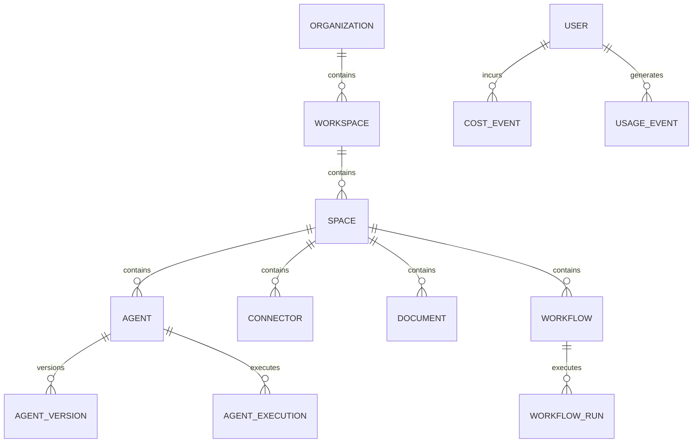

# DATABASE_SCHEMA.md

# Business Copilot Platform Database Design

---

# Purpose

This document defines the complete database architecture for the Business Copilot Platform.

The schema is designed to support:

* Multi-tenancy
* Spaces
* Agents
* Connectors
* Workflows
* Semantic Models
* Knowledge Bases
* Cost Tracking
* Usage Analytics
* Governance
* Agent Sharing
* Marketplace

---

# Database Technologies

## Primary Database

PostgreSQL

Purpose:

* Transactional data
* Metadata
* Configurations
* Analytics Aggregations

---

## Vector Database

pgvector

Purpose:

* Embeddings
* Semantic Search
* Knowledge Retrieval

---

## Cache Layer

Redis

Purpose:

* Session State
* Celery Broker
* Short-Term Memory
* Query Cache

---

# Schema Design Principles

## Principle 1

Every table must support multi-tenancy.

Required hierarchy:

```text
Organization
 └── Workspace
      └── Space
```

---

## Principle 2

All primary keys use UUID.

Example:

```sql
id UUID PRIMARY KEY
```

---

## Principle 3

Every major table includes audit fields.

```sql
created_at TIMESTAMP
updated_at TIMESTAMP
created_by UUID
updated_by UUID
```

---

## Principle 4

Soft deletion preferred over hard deletion.

```sql
deleted_at TIMESTAMP
```

---

# High-Level ER Diagram



---

# Domain 1: Tenant Management

## organizations

Represents a customer organization.

### Columns

| Column     | Type      | Description       |
| ---------- | --------- | ----------------- |
| id         | UUID      | Primary Key       |
| name       | TEXT      | Organization Name |
| slug       | TEXT      | Unique URL Slug   |
| status     | TEXT      | Active, Suspended |
| plan_id    | UUID      | Subscription Plan |
| created_at | TIMESTAMP | Creation Date     |
| updated_at | TIMESTAMP | Update Date       |

### Example

```sql
CREATE TABLE organizations (
    id UUID PRIMARY KEY,
    name TEXT NOT NULL,
    slug TEXT UNIQUE NOT NULL,
    status TEXT NOT NULL,
    plan_id UUID,
    created_at TIMESTAMP NOT NULL,
    updated_at TIMESTAMP NOT NULL
);
```

---

## workspaces

Represents departments or teams.

Examples:

* Finance
* Sales
* Marketing
* Operations

### Columns

| Column          | Type      |
| --------------- | --------- |
| id              | UUID      |
| organization_id | UUID      |
| name            | TEXT      |
| description     | TEXT      |
| created_at      | TIMESTAMP |

### Relationships

```text
Organization
 └── Workspace
```

---

## spaces

Execution boundary for agents and connectors.

### Columns

| Column       | Type      |
| ------------ | --------- |
| id           | UUID      |
| workspace_id | UUID      |
| name         | TEXT      |
| description  | TEXT      |
| status       | TEXT      |
| created_at   | TIMESTAMP |

### Relationships

```text
Workspace
 └── Space
```

### Notes

A space can contain:

* Multiple Agents
* Multiple Connectors
* Multiple Workflows
* Multiple Documents

---

# Domain 2: Identity & Access Management

## users

Represents platform users.

### Columns

| Column          | Type      |
| --------------- | --------- |
| id              | UUID      |
| organization_id | UUID      |
| email           | TEXT      |
| full_name       | TEXT      |
| status          | TEXT      |
| last_login      | TIMESTAMP |
| created_at      | TIMESTAMP |

### Example

```sql
CREATE TABLE users (
    id UUID PRIMARY KEY,
    organization_id UUID NOT NULL,
    email TEXT UNIQUE NOT NULL,
    full_name TEXT,
    status TEXT NOT NULL,
    last_login TIMESTAMP,
    created_at TIMESTAMP NOT NULL
);
```

---

## roles

Role definitions.

Examples:

* Admin
* Manager
* Analyst
* Viewer

### Columns

| Column          | Type |
| --------------- | ---- |
| id              | UUID |
| organization_id | UUID |
| name            | TEXT |
| description     | TEXT |

---

## permissions

Atomic permission definitions.

Examples:

```text
agent:create
agent:delete
connector:create
workflow:execute
```

### Columns

| Column        | Type |
| ------------- | ---- |
| id            | UUID |
| resource_type | TEXT |
| action        | TEXT |

---

## role_permissions

Maps permissions to roles.

### Columns

| Column        | Type |
| ------------- | ---- |
| role_id       | UUID |
| permission_id | UUID |

---

## user_roles

Assigns roles to users.

### Columns

| Column       | Type |
| ------------ | ---- |
| user_id      | UUID |
| role_id      | UUID |
| workspace_id | UUID |

---

# Domain 3: Agent Platform

## agents

Core agent definition.

### Columns

| Column      | Type      |
| ----------- | --------- |
| id          | UUID      |
| space_id    | UUID      |
| owner_id    | UUID      |
| name        | TEXT      |
| description | TEXT      |
| goal        | TEXT      |
| status      | TEXT      |
| visibility  | TEXT      |
| created_at  | TIMESTAMP |
| updated_at  | TIMESTAMP |

### Status Values

```text
Draft
Testing
Published
Active
Archived
Disabled
```

### Visibility Values

```text
Private
Shared
Workspace
Organization
Marketplace
```

---

## agent_versions

Stores version history.

### Columns

| Column         | Type      |
| -------------- | --------- |
| id             | UUID      |
| agent_id       | UUID      |
| version_number | INTEGER   |
| configuration  | JSONB     |
| created_by     | UUID      |
| created_at     | TIMESTAMP |

### Purpose

Supports:

* Rollback
* Auditability
* Publishing Workflow

---

## agent_memory_profiles

Defines memory behavior.

### Columns

| Column        | Type  |
| ------------- | ----- |
| id            | UUID  |
| agent_id      | UUID  |
| memory_type   | TEXT  |
| configuration | JSONB |

### Memory Types

```text
Conversation
Agent
Workspace
Semantic
```

---

## agent_executions

Tracks every execution.

### Columns

| Column       | Type      |
| ------------ | --------- |
| id           | UUID      |
| agent_id     | UUID      |
| user_id      | UUID      |
| status       | TEXT      |
| started_at   | TIMESTAMP |
| completed_at | TIMESTAMP |
| cost         | NUMERIC   |

### Purpose

Supports:

* Analytics
* Cost Tracking
* Debugging
* SLA Monitoring

---

## agent_execution_steps

Stores internal execution trace.

### Columns

| Column       | Type  |
| ------------ | ----- |
| id           | UUID  |
| execution_id | UUID  |
| step_type    | TEXT  |
| tool_name    | TEXT  |
| input        | JSONB |
| output       | JSONB |

### Example Step Types

```text
Planning
Retrieval
ToolCall
Reasoning
Validation
Response
```

---

# Domain 4: Agent Sharing

## agent_shares

Controls sharing permissions.

### Columns

| Column           | Type      |
| ---------------- | --------- |
| id               | UUID      |
| agent_id         | UUID      |
| shared_with_user | UUID      |
| role             | TEXT      |
| created_at       | TIMESTAMP |

### Roles

```text
Owner
Admin
Editor
Viewer
Executor
```

---

## marketplace_agents

Published marketplace entries.

### Columns

| Column       | Type    |
| ------------ | ------- |
| id           | UUID    |
| agent_id     | UUID    |
| published_by | UUID    |
| certified    | BOOLEAN |
| downloads    | INTEGER |

### Purpose

Supports:

* Internal Marketplace
* Certified Agents
* Team Sharing

---

# Remaining Domains

The full schema continues with:

## Domain 5

Connector Platform

* connectors
* connector_credentials
* connector_sync_jobs
* connector_metadata

---

## Domain 6

Knowledge Platform

* documents
* document_chunks
* embeddings
* knowledge_collections

---

## Domain 7

Semantic Layer

* business_terms
* metrics
* semantic_models

---

## Domain 8

Business Rules

* business_rules
* rule_versions

---

## Domain 9

Workflow Engine

* workflows
* workflow_runs
* workflow_steps
* scheduled_jobs

---

## Domain 10

Celery Infrastructure

* celery_tasks
* celery_task_metrics

---

## Domain 11

Usage Analytics

* usage_events
* agent_usage_daily
* connector_usage_daily

---

## Domain 12

FinOps

* cost_events
* budgets
* user_budgets
* cost_forecasts

---

## Domain 13

Quota Management

* storage_quotas
* storage_usage
* archival_policies

---

## Domain 14

Governance

* audit_logs
* compliance_policies
* data_classifications

---

## Domain 15

Observability

* traces
* metrics_snapshots

---

# Alembic Standards

All schema changes must use Alembic.

Required Process:

```bash
alembic revision --autogenerate
alembic upgrade head
```

Never modify production schema manually.

---

# Partitioning Strategy

The following tables must be partitioned by month:

* usage_events
* cost_events
* audit_logs
* workflow_runs
* agent_executions

Example:

```sql
PARTITION BY RANGE(created_at)
```

---

# Indexing Standards

Required indexes:

* organization_id
* workspace_id
* space_id
* user_id
* agent_id
* connector_id
* workflow_id
* created_at
* status

These indexes are mandatory for enterprise-scale performance.
