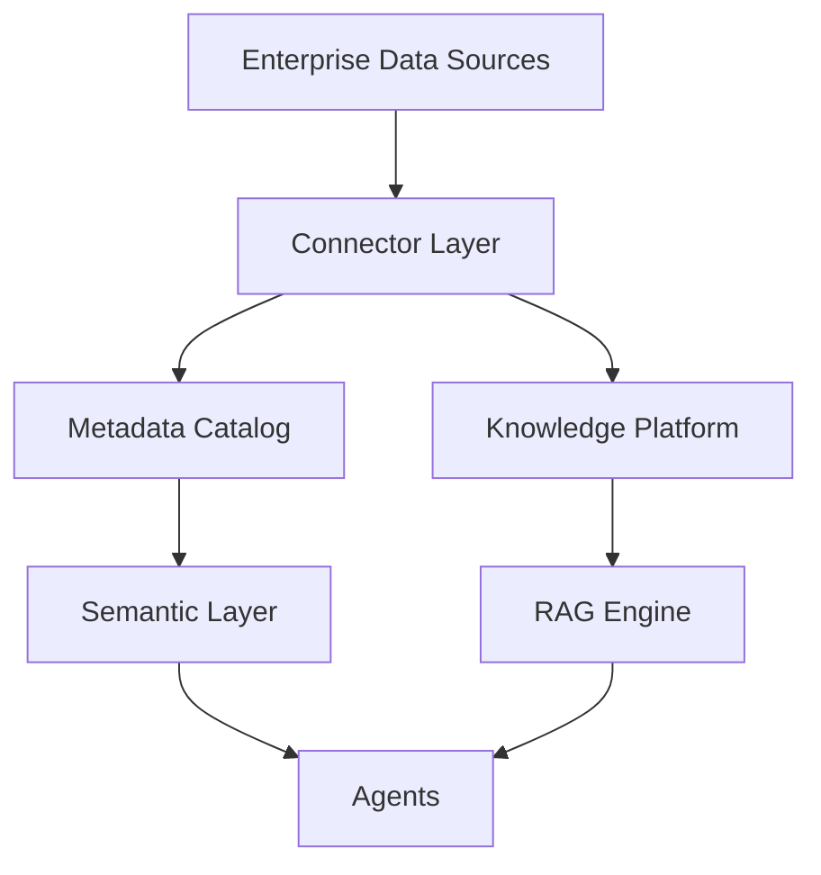
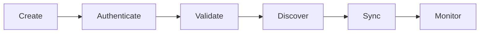
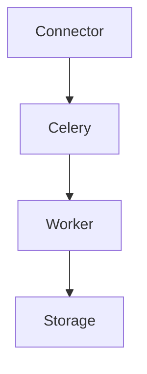
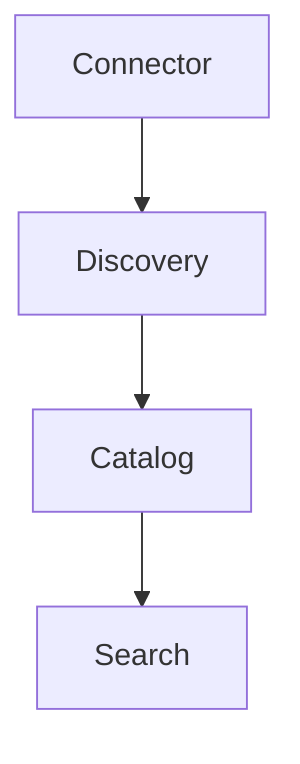
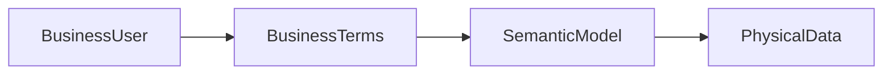
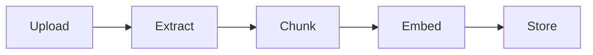
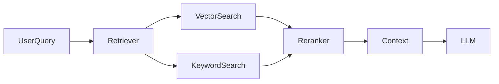
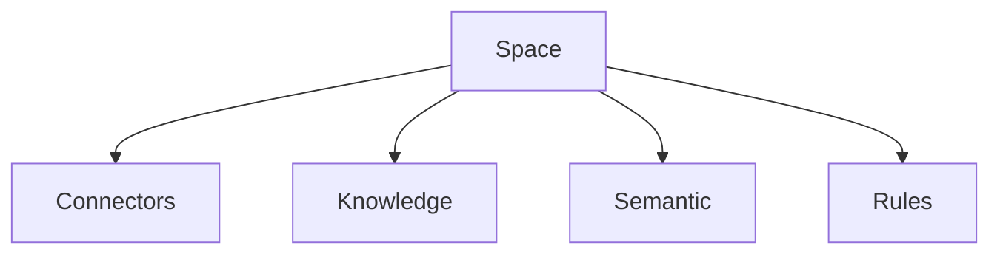
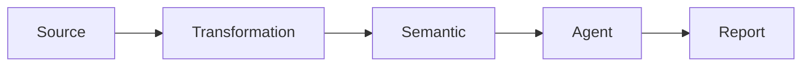

# DATA_PLATFORM.md

# Data Platform Specification

---

# Purpose

The Data Platform is the intelligence foundation of the Business Copilot Platform.

Without reliable data, agents become generic chatbots.

The Data Platform transforms enterprise data into an AI-ready knowledge ecosystem.

It is responsible for:

* Data Connectivity
* Data Ingestion
* Data Synchronization
* Metadata Discovery
* Semantic Modeling
* Knowledge Management
* Retrieval
* Governance
* Data Lineage

---

# Core Objectives

The Data Platform must allow users to:

* Connect any business system
* Search across all connected systems
* Query business data using natural language
* Build business definitions
* Create reusable semantic models
* Power agents with trusted enterprise knowledge

---

# Data Platform Architecture



---

# Core Components

## Connector Platform

Responsible for:

* Authentication
* Connectivity
* Synchronization
* Metadata Discovery
* Query Execution

---

## Metadata Catalog

Responsible for:

* Source Discovery
* Schema Discovery
* Column Discovery
* Ownership Tracking
* Data Freshness Tracking

---

## Semantic Layer

Responsible for:

* Business Terminology
* Metrics
* KPI Definitions
* Business Models

---

## Knowledge Platform

Responsible for:

* Documents
* Files
* Knowledge Bases
* Embeddings

---

## Retrieval Layer

Responsible for:

* Search
* Semantic Search
* Hybrid Search
* Context Retrieval

---

# Connector Framework

Every connector must implement the same interface.

```python
class BaseConnector:

    async def connect(self):
        pass

    async def validate(self):
        pass

    async def discover_schema(self):
        pass

    async def sync(self):
        pass

    async def search(self):
        pass

    async def execute(self):
        pass
```

---

# Connector Categories

## Database Connectors

Examples:

* PostgreSQL
* MySQL
* SQL Server
* Snowflake
* BigQuery
* Redshift
* Databricks

---

## SaaS Connectors

Examples:

* Salesforce
* HubSpot
* SAP
* Oracle
* NetSuite
* Zendesk
* Jira

---

## Document Connectors

Examples:

* SharePoint
* OneDrive
* Google Drive
* Box
* Dropbox

---

## Communication Connectors

Examples:

* Slack
* Microsoft Teams
* Email

---

## API Connectors

Examples:

* REST
* GraphQL
* SOAP

---

# Connector Lifecycle



---

# Connector Metadata

Every connector must maintain:

| Attribute               | Description         |
| ----------------------- | ------------------- |
| Name                    | Connector Name      |
| Type                    | Database, SaaS, API |
| Owner                   | Responsible User    |
| Freshness               | Last Sync           |
| Status                  | Active/Inactive     |
| Security Classification | Data Sensitivity    |
| Space                   | Assigned Space      |

---

# Data Synchronization

Supported Modes:

---

## Manual Sync

User-triggered synchronization.

---

## Scheduled Sync

Celery Beat schedules synchronization.

Examples:

* Hourly
* Daily
* Weekly

---

## Event Sync

Triggered by external events.

Examples:

* Webhooks
* CDC
* Queue Events

---

# Sync Architecture



---

# Metadata Catalog

The Metadata Catalog serves as the central inventory.

---

## Stored Metadata

### Sources

* Databases
* SaaS Systems
* APIs

---

### Schemas

* Tables
* Views
* Objects

---

### Columns

* Names
* Types
* Descriptions

---

### Ownership

* Team
* Department
* Steward

---

### Freshness

* Last Refresh
* Frequency

---

# Metadata Architecture



---

# Semantic Layer

The Semantic Layer is the most important differentiator.

Business users should never need to know:

* Table names
* Join paths
* Database schemas

---

Instead they should use:

* Revenue
* Customers
* Churn
* Pipeline
* Gross Margin

---

# Semantic Layer Components

## Business Glossary

Defines business terms.

Example:

Revenue

Definition:

Net sales minus returns.

---

## Metric Registry

Defines KPIs.

Examples:

* Revenue
* ARR
* Churn Rate
* Gross Margin

---

## Semantic Models

Maps business concepts to physical data.

Example:

```text
Revenue
=
sales_fact.net_sales
-
returns_fact.amount
```

---

# Semantic Architecture



---

# KPI Engine

Every KPI should include:

| Field    | Description       |
| -------- | ----------------- |
| Name     | KPI Name          |
| Formula  | Business Formula  |
| Owner    | Business Owner    |
| Category | Finance, Sales    |
| Version  | KPI Version       |
| Status   | Active/Deprecated |

---

# Business Rule Layer

Examples:

---

Revenue

```text
Net Sales - Returns
```

---

High Risk Customer

```text
ARR > 100000

AND

Health Score < 70
```

---

Inventory Alert

```text
Inventory < Safety Stock
```

---

# Knowledge Platform

Responsible for:

* Documents
* Reports
* Presentations
* SOPs
* Wikis

---

# Supported Formats

| Format   |
| -------- |
| PDF      |
| DOCX     |
| XLSX     |
| PPTX     |
| TXT      |
| CSV      |
| HTML     |
| Markdown |

---

# Knowledge Ingestion Pipeline



---

# Document Processing

Stages:

1. Upload
2. OCR
3. Text Extraction
4. Chunking
5. Embedding
6. Indexing

---

# Chunking Strategy

Supported Methods:

---

## Fixed Size

Example:

1000 tokens

---

## Recursive Chunking

Preferred.

Maintains semantic boundaries.

---

## Section-Based

Ideal for reports.

---

# Embedding Strategy

Purpose:

Convert text into vector representations.

---

Stores:

* Chunk Embeddings
* Metadata
* References

---

# Vector Storage

Technology:

pgvector

---

Stores:

* Embeddings
* Similarity Indexes
* Knowledge Chunks

---

# Retrieval Architecture



---

# Retrieval Strategy

Preferred approach:

Hybrid Retrieval

---

Components:

* Semantic Search
* Keyword Search
* Metadata Filtering
* Reranking

---

# Context Assembly

Context should include:

* Retrieved Documents
* Business Definitions
* KPIs
* Connector Results

---

# Space-Based Isolation

Every Space owns:

* Connectors
* Knowledge Bases
* Documents
* Semantic Models
* Business Rules

---

# Space Architecture



---

# Cross-Space Access

Disabled by default.

Requires:

* Explicit Permission
* Audit Logging

---

# Data Governance

Every asset must support:

* Ownership
* Classification
* Retention
* Auditability

---

# Data Classifications

Supported Levels:

* Public
* Internal
* Confidential
* Restricted

---

# Data Lineage

Track:

* Source System
* Transformations
* Semantic Models
* Agent Usage

---

# Lineage Architecture



---

# Data Quality Framework

Metrics:

* Completeness
* Freshness
* Accuracy
* Consistency
* Validity

---

# Quality Monitoring

Generate alerts when:

* Sync fails
* Data missing
* Schema changes
* Freshness thresholds violated

---

# Search Experience

Users should search across:

* Databases
* Documents
* Knowledge Bases
* Connectors
* Semantic Models

from a single interface.

---

# Analytics

Track:

* Connector Usage
* Search Queries
* Retrieval Accuracy
* Knowledge Utilization
* Semantic Model Usage

---

# Cost Tracking

Track cost by:

* Connector
* Space
* User
* Agent
* Embedding Operations
* Retrieval Operations

---

# Storage Management

Track:

* Documents
* Chunks
* Embeddings
* Metadata

Support:

* Quotas
* Archival
* Forecasting

---

# Security

All connector credentials:

* Encrypted
* Rotated
* Audited

Never exposed to agents directly.

---

# Observability

Track:

* Sync Duration
* Query Duration
* Retrieval Latency
* Embedding Latency
* Search Accuracy

---

# Future Enhancements

* Knowledge Graph
* Graph RAG
* Data Contracts
* Automatic Semantic Model Generation
* AI-Powered Metadata Discovery
* Autonomous Data Quality Monitoring
* Federated Search
* Real-Time Knowledge Refresh

---

# Success Metrics

The Data Platform is successful when:

* Business users can find information without technical assistance.
* Agents consistently retrieve accurate business context.
* Connectors remain reliable and observable.
* Semantic definitions become the trusted business language.
* Knowledge is reusable across teams and spaces.
