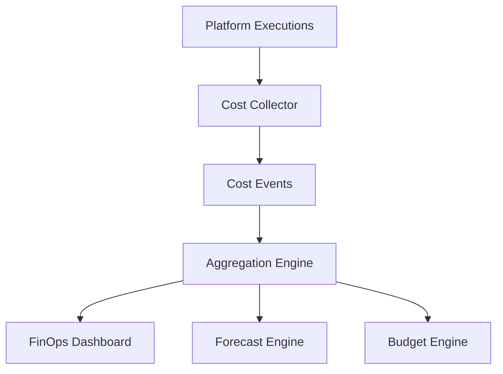
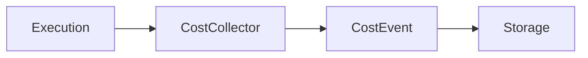
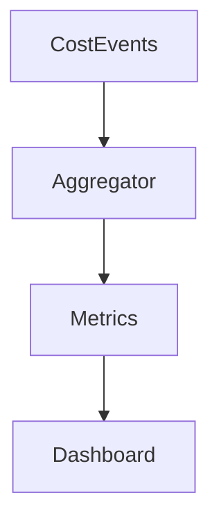
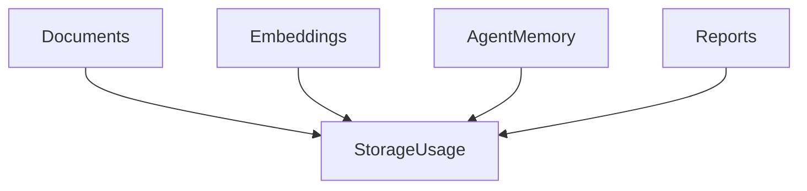
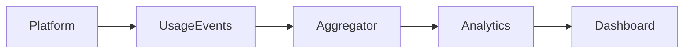

# FINOPS.md

# Financial Operations (FinOps) Platform Specification

---

# Purpose

The FinOps Platform is responsible for making AI usage financially transparent, predictable, and controllable.

Unlike traditional SaaS products, AI systems incur variable costs on every interaction.

Every:

* Chat
* Agent Execution
* Workflow Run
* Connector Query
* Embedding Operation
* Retrieval Operation

creates cost.

The FinOps Platform ensures that organizations understand:

* Where money is being spent
* Who is spending it
* Which agents generate value
* Which workflows are inefficient
* Which teams are consuming resources

---

# Objectives

The FinOps Platform must provide:

* Cost Visibility
* Cost Attribution
* Cost Forecasting
* Budget Controls
* Usage Analytics
* Storage Management
* Quota Management
* Chargeback Reporting

---

# FinOps Architecture



---

# Core Principles

## Principle 1

Every operation generates a cost event.

No exceptions.

---

## Principle 2

Every cost must be attributable.

A cost event must always identify:

* Organization
* Workspace
* Space
* User
* Agent
* Workflow

---

## Principle 3

Cost calculations must be auditable.

Users should always be able to understand:

Why a cost occurred.

---

# Cost Attribution Hierarchy

```text
Organization
 └── Workspace
      └── Space
           └── User
                └── Agent
                     └── Execution
```

---

# Cost Categories

## LLM Costs

Examples:

* Input Tokens
* Output Tokens
* Reasoning Tokens
* Tool Calls

---

## Embedding Costs

Examples:

* Document Embeddings
* Semantic Models
* Memory Indexing

---

## Retrieval Costs

Examples:

* Vector Search
* Reranking
* Semantic Search

---

## Connector Costs

Examples:

* Snowflake Queries
* BigQuery Queries
* Salesforce API Calls

---

## Workflow Costs

Examples:

* Workflow Executions
* Scheduled Jobs
* Celery Workers

---

## Storage Costs

Examples:

* Documents
* Embeddings
* Reports
* Agent Memory

---

# Cost Event Architecture

Every execution creates a cost event.



---

# Cost Event Schema

## Required Fields

| Field           | Description  |
| --------------- | ------------ |
| organization_id | Organization |
| workspace_id    | Workspace    |
| space_id        | Space        |
| user_id         | User         |
| agent_id        | Agent        |
| workflow_id     | Workflow     |
| connector_id    | Connector    |
| cost_type       | Category     |
| amount          | Cost         |
| timestamp       | Event Time   |

---

# Cost Tracking Scope

## Organization Level

Tracks:

* Total Spend
* Budget
* Forecast

---

## Workspace Level

Tracks:

* Department Spend
* Department Forecast

---

## Space Level

Tracks:

* Team Spend
* Team Usage

---

## User Level

Tracks:

* Personal Spend
* Personal Consumption

---

## Agent Level

Tracks:

* Cost Per Agent
* Cost Per Execution

---

## Workflow Level

Tracks:

* Cost Per Run
* Monthly Cost

---

# Dashboard Architecture



---

# User Dashboard

Every user should see:

## Current Month Spend

Example:

```text
$42.71
```

---

## Budget Usage

Example:

```text
42% Used
```

---

## Remaining Budget

Example:

```text
$57.29 Remaining
```

---

## Top Agents

Most expensive agents.

---

## Top Workflows

Most expensive workflows.

---

# Workspace Dashboard

Managers should see:

* Team Spend
* Top Users
* Top Agents
* Forecasted Spend

---

# Organization Dashboard

Executives should see:

* Total Spend
* Department Spend
* Growth Trends
* Forecast

---

# Cost Breakdown

Break costs by:

* Agent
* Workflow
* Connector
* User
* Model
* Space

---

# Cost Formula

```text
Total Cost

=

LLM Cost

+

Embedding Cost

+

Connector Cost

+

Workflow Cost

+

Storage Cost
```

---

# Model Cost Tracking

Track per model.

Examples:

* GPT-5
* GPT-5 Mini
* Embedding Models
* Future Providers

---

## Metrics

Track:

* Prompt Tokens
* Completion Tokens
* Total Tokens
* Cost

---

# Agent Cost Tracking

Every agent execution generates:

```text
Execution Cost

=

Prompt Cost

+

Completion Cost

+

Connector Cost

+

Workflow Cost
```

---

# Agent Cost Dashboard

Metrics:

* Cost Per Execution
* Daily Cost
* Monthly Cost
* Cost Trend

---

# Workflow Cost Tracking

Track:

* Execution Count
* Cost Per Run
* Monthly Cost

---

# Connector Cost Tracking

Track:

* API Calls
* Query Cost
* Sync Cost

---

# Connector Dashboard

Metrics:

* Most Expensive Connectors
* Cost Trends
* Query Volume

---

# Storage Management

Storage is a first-class billing component.

---

# Storage Types

## Documents

Examples:

* PDFs
* Reports
* Presentations

---

## Embeddings

Examples:

* Knowledge Chunks
* Semantic Models

---

## Agent Storage

Examples:

* Configurations
* Memory

---

## Workflow Storage

Examples:

* Definitions
* Logs

---

# Storage Architecture



---

# Quota Management

Quotas should be configurable.

---

# Quota Levels

## Organization

Highest level.

---

## Workspace

Department level.

---

## Space

Team level.

---

## User

Individual level.

---

# Quota Types

## Storage Quota

GB consumed.

---

## Agent Quota

Agent count.

---

## Workflow Quota

Workflow count.

---

## Connector Quota

Connector count.

---

## Token Quota

Monthly AI consumption.

---

# Dynamic Quotas

Quotas should be adjustable.

Example:

```text
Default User

10 GB Storage

↓

Power User

100 GB Storage
```

---

# Agent Capacity Management

A user should never lose agents.

---

# Agent States

```text
Active

Archived

Disabled
```

---

# Recommendation

Do not limit total agent count.

Instead:

* Limit Active Agents
* Archive unused agents

---

# Agent Archival Policy

Example:

```text
No Usage For 180 Days

↓

Archive Agent
```

---

# Usage Analytics

Track:

* Daily Usage
* Weekly Usage
* Monthly Usage

---

# Usage Events

Every action generates:

* Usage Event
* Cost Event

---

# Usage Pipeline



---

# Agent Analytics

Metrics:

* Executions
* Users
* Cost
* Adoption

---

# Agent Health Score

Formula:

```text
Health Score

=

Usage

+

Adoption

+

Reliability

-

Cost Penalty
```

---

# Workflow Analytics

Metrics:

* Runs
* Failures
* Duration
* Cost

---

# Connector Analytics

Metrics:

* Queries
* Syncs
* Failures
* Cost

---

# Cost Forecasting

The platform should estimate future spend.

---

# Forecast Inputs

* Historical Spend
* Usage Growth
* Active Users
* Agent Usage

---

# Forecast Outputs

## End of Month Spend

Example:

```text
Forecast:

$1,250
```

---

## Budget Risk

Example:

```text
85% Probability Of Budget Exceedance
```

---

# Budget Controls

Organizations may define:

* Monthly Budgets
* Workspace Budgets
* User Budgets

---

# Budget Actions

## Warn

Notify user.

---

## Throttle

Reduce access.

---

## Restrict

Prevent execution.

---

## Require Approval

Manager approval required.

---

# Chargeback Model

Support internal cost allocation.

---

# Example

```text
Finance Team

$420

Sales Team

$610

Operations

$280
```

---

# Executive Reporting

Generate:

## Weekly Reports

Includes:

* Spend
* Trends
* Adoption

---

## Monthly Reports

Includes:

* Department Breakdown
* Top Agents
* Forecasts

---

## Quarterly Reports

Includes:

* ROI Analysis
* Growth Analysis

---

# FinOps Automation

Use Celery for:

* Cost Aggregation
* Forecast Generation
* Budget Monitoring
* Report Generation

---

# Cost Optimization Engine

Recommend:

## Archive Agents

Unused and expensive.

---

## Merge Agents

Duplicate functionality.

---

## Change Models

Use cheaper models where possible.

---

## Reduce Embeddings

Optimize storage.

---

# Alerts

Trigger alerts when:

* Budget Threshold Reached
* Cost Spike Detected
* Storage Limit Reached
* Abnormal Usage Detected

---

# Security

Only authorized users can access cost data.

---

# Audit Requirements

Every budget modification must be logged.

Every quota modification must be logged.

Every billing adjustment must be logged.

---

# Future Enhancements

* AI ROI Scoring
* Cost Anomaly Detection
* Predictive Budgeting
* Agent Profitability Analysis
* Department Benchmarking
* Automatic Cost Optimization

---

# Success Metrics

The FinOps Platform is successful when:

* Users understand their AI spending.
* Departments control budgets.
* Costs are attributable.
* Forecasts are accurate.
* Optimization opportunities are identified.
* AI adoption scales without cost surprises.

The FinOps Platform is a foundational pillar of the Business Copilot Platform and should be treated as a first-class product capability rather than an administrative feature.
