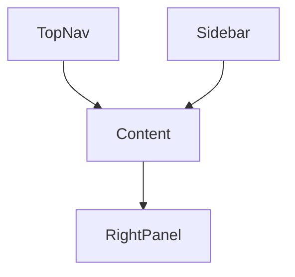

# FRONTEND_SPEC.md

# Business Copilot Platform Frontend Specification

---

# Purpose

This document defines:

* User Experience
* Information Architecture
* Navigation
* Screens
* Components
* Design System
* Interaction Patterns

The frontend should feel like a modern combination of:

* Microsoft Copilot
* Notion
* Slack
* Salesforce
* ThoughtSpot

while remaining business-user friendly.

---

# Frontend Goals

The platform should allow users to:

* Chat with AI
* Build Agents
* Connect Data Sources
* Create Workflows
* Manage Spaces
* Monitor Costs
* Collaborate with Teams

without writing code.

---

# Technology Stack

## Framework

React

TypeScript

---

## State Management

Zustand

TanStack Query

---

## Forms

React Hook Form

Zod

---

## Styling

TailwindCSS

---

## Charts

Recharts

ECharts

---

## Tables

AG Grid

TanStack Table

---

# Design Principles

## Principle 1

AI First

Chat should be available globally.

---

## Principle 2

Business User Friendly

Avoid technical terminology.

---

## Principle 3

Everything Discoverable

Users should never need documentation to find features.

---

## Principle 4

Minimal Clicks

Important actions ≤ 3 clicks.

---

# Global Layout



---

# Application Layout

```text
+------------------------------------------------+
| Top Navigation                                 |
+------------------------------------------------+
| Sidebar | Main Content        | Context Panel |
|         |                     |               |
|         |                     |               |
+------------------------------------------------+
```

---

# Top Navigation

Contains:

* Global Search
* Notifications
* Chat Access
* User Profile
* Organization Switcher
* Workspace Switcher

---

# Left Navigation

Primary Navigation.

```text
Home

Chat

Spaces

Agents

Connectors

Knowledge

Workflows

Analytics

FinOps

Governance

Marketplace

Administration
```

---

# Home Dashboard

Route:

```text
/
```

---

# Purpose

Landing page.

Provides overview of platform activity.

---

# Widgets

## My Agents

Recently used agents.

---

## Active Spaces

Recent spaces.

---

## Cost Overview

Current month spend.

---

## Workflow Activity

Recent workflow runs.

---

## Notifications

Important alerts.

---

## Recommendations

Suggested actions.

Examples:

* Archive unused agents
* Approve pending workflow
* Connector sync failure

---

# Home Dashboard Layout

```text
+---------------------------------------+
| My Agents                             |
+---------------------------------------+

+----------------+----------------------+
| Costs          | Workflows            |
+----------------+----------------------+

+---------------------------------------+
| Recommendations                       |
+---------------------------------------+
```

---

# Global Chat Experience

Route:

```text
/chat
```

---

# Purpose

Universal conversational interface.

---

# Layout

```text
+---------------------------------------+
| Conversation History                  |
+---------------------------------------+

| Chat Window                           |
|                                       |
|                                       |
+---------------------------------------+

| Input Box                             |
+---------------------------------------+
```

---

# Chat Features

## Natural Language Queries

Example:

```text
Why did revenue decline?
```

---

## Agent Selection

Choose:

* General Copilot
* Specific Agent

---

## File Upload

Attach:

* PDFs
* Excel Files
* CSV Files

---

## Citations

Display source references.

---

## Suggested Follow-Ups

Generated automatically.

---

# Chat Side Panel

Displays:

* Sources
* Connected Connectors
* Agent Information
* Cost Information

---

# Spaces

Route:

```text
/spaces
```

---

# Purpose

Spaces are operational work environments.

---

# Space List Screen

Display:

* Name
* Owner
* Agents
* Connectors
* Documents
* Cost

---

# Create Space Wizard

Step 1

Identity

* Name
* Description

---

Step 2

Permissions

* Members
* Roles

---

Step 3

Resources

* Agents
* Connectors

---

# Space Detail Page

Tabs:

```text
Overview

Agents

Connectors

Documents

Semantic Models

Workflows

Analytics

Settings
```

---

# Agent Platform

Route:

```text
/agents
```

---

# Agent Catalog

Displays:

* Active Agents
* Shared Agents
* Marketplace Agents

---

# Agent Card

Display:

```text
Name

Description

Owner

Health Score

Monthly Cost

Executions
```

---

# Agent Detail Page

Tabs:

```text
Overview

Instructions

Memory

Connectors

Business Rules

Analytics

Versions

Sharing

Settings
```

---

# Agent Builder

Route:

```text
/agents/create
```

---

# Agent Builder Wizard

## Step 1

Basic Information

* Name
* Description
* Category

---

## Step 2

Goal Definition

Examples:

```text
Analyze revenue trends

Detect customer churn

Forecast demand
```

---

## Step 3

Connector Selection

Select:

* Databases
* SaaS Systems
* APIs

---

## Step 4

Business Rules

Visual rule builder.

Example:

```text
Revenue Drop > 10%

↓

Create Alert
```

---

## Step 5

Memory Configuration

Choose:

* Session
* Agent
* Space

---

## Step 6

Tools

Enable:

* Search
* SQL
* Email
* Workflow

---

## Step 7

Testing

Sandbox execution.

---

## Step 8

Publish

Make available.

---

# Agent Analytics

Route:

```text
/agents/{id}/analytics
```

---

# Dashboard Widgets

## Usage

Daily executions.

---

## Cost

Monthly spend.

---

## Adoption

Active users.

---

## Reliability

Success rate.

---

## Health Score

Overall score.

---

# Connector Platform

Route:

```text
/connectors
```

---

# Connector Catalog

Grouped by:

* Databases
* SaaS
* Documents
* APIs

---

# Connector Setup Wizard

Step 1

Connector Type

---

Step 2

Authentication

---

Step 3

Validation

---

Step 4

Schema Discovery

---

Step 5

Sync Schedule

---

# Connector Detail Page

Tabs:

```text
Overview

Metadata

Sync History

Analytics

Permissions

Settings
```

---

# Knowledge Platform

Route:

```text
/knowledge
```

---

# Purpose

Document and knowledge management.

---

# Knowledge Dashboard

Displays:

* Documents
* Collections
* Embeddings
* Storage Usage

---

# Document Upload

Drag-and-drop interface.

Supported:

* PDF
* DOCX
* XLSX
* PPTX

---

# Semantic Layer

Route:

```text
/semantic
```

---

# Tabs

```text
Business Terms

Metrics

Semantic Models

Lineage

Validation
```

---

# Business Term Editor

Fields:

* Name
* Definition
* Owner

---

# Metric Builder

Fields:

* Formula
* Source
* Validation

---

# Workflow Platform

Route:

```text
/workflows
```

---

# Workflow Dashboard

Displays:

* Active Workflows
* Scheduled Workflows
* Failed Workflows

---

# Workflow Builder

Visual Canvas.

---

# Workflow Components

Drag-and-drop:

* Trigger
* Agent
* Connector
* Condition
* Approval
* Notification

---

# Workflow Canvas

```text
Trigger

↓

Agent

↓

Condition

↓

Notification
```

---

# Workflow Monitoring

Shows:

* Status
* Duration
* Errors
* Cost

---

# Analytics Platform

Route:

```text
/analytics
```

---

# Analytics Sections

## Agent Analytics

---

## Workflow Analytics

---

## Connector Analytics

---

## Space Analytics

---

## Workspace Analytics

---

# Dashboard Widgets

* Usage Trends
* Adoption Trends
* Cost Trends
* Reliability Trends

---

# FinOps Platform

Route:

```text
/finops
```

---

# Purpose

Cost visibility.

---

# FinOps Dashboard

Widgets:

## Current Spend

---

## Budget Remaining

---

## Forecast

---

## Cost Breakdown

---

## Top Cost Drivers

---

# Budget Progress Bar

```text
Monthly Budget

████████░░░░

80%
```

---

# Cost Breakdown View

Dimensions:

* Agent
* Workflow
* User
* Space
* Connector

---

# Governance Platform

Route:

```text
/governance
```

---

# Sections

## Users

---

## Roles

---

## Permissions

---

## Audit Logs

---

## Compliance

---

# Audit Viewer

Filters:

* User
* Action
* Resource
* Date

---

# Marketplace

Route:

```text
/marketplace
```

---

# Features

* Browse Agents
* Search Agents
* Install Agents
* Rate Agents

---

# Marketplace Card

Display:

```text
Agent Name

Category

Downloads

Rating

Owner
```

---

# Notifications Center

Global feature.

---

# Notification Types

* Approval Requests
* Workflow Failures
* Cost Alerts
* Security Alerts

---

# Search Experience

Global search available everywhere.

Search across:

* Agents
* Spaces
* Connectors
* Documents
* Workflows

---

# User Profile

Route:

```text
/profile
```

---

# Sections

* Preferences
* API Keys
* Usage
* Cost
* Security

---

# Mobile Support

Support:

* Dashboard Viewing
* Chat
* Notifications
* Approvals

Complex builders remain desktop-first.

---

# Accessibility

Support:

* Keyboard Navigation
* Screen Readers
* Color Contrast Standards

---

# Theme Support

* Light Theme
* Dark Theme

---

# Future Enhancements

* Real-Time Collaboration
* Multi-User Agent Editing
* Shared Chat Sessions
* Whiteboard Planning
* Agent Performance Heatmaps
* AI-Powered UI Recommendations

---

# Success Metrics

The Frontend is successful when:

* Business users can create agents without training.
* Navigation remains intuitive.
* Cost visibility is immediate.
* Workflows are understandable.
* Collaboration is frictionless.
* Chat remains the primary interaction model.

The frontend should feel like an Enterprise AI Operating System rather than a collection of disconnected tools.
