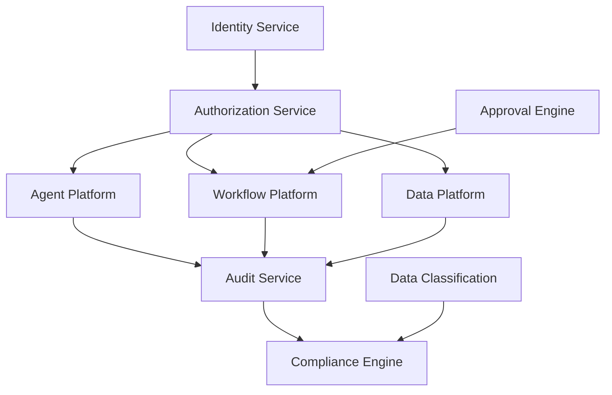
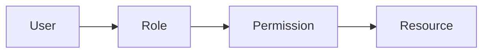
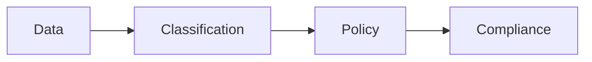
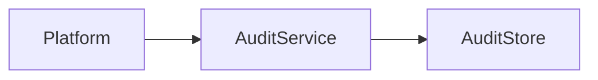
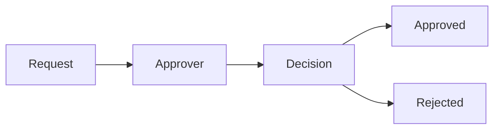

# GOVERNANCE.md

# Governance, Security & Compliance Platform Specification

---

# Purpose

The Governance Platform ensures that the Business Copilot Platform remains:

* Secure
* Compliant
* Auditable
* Controllable
* Enterprise Ready

Without governance, organizations will not trust agents with sensitive business operations.

Governance is not a supporting feature.

It is a platform-wide capability that affects:

* Users
* Organizations
* Workspaces
* Spaces
* Agents
* Connectors
* Documents
* Semantic Models
* Workflows
* Cost Data

---

# Governance Objectives

The platform must provide:

* Authentication
* Authorization
* Data Security
* Tenant Isolation
* Auditability
* Compliance
* Data Governance
* Approval Management

---

# Governance Architecture



---

# Governance Hierarchy

Every permission originates from:

```text
Organization
 └── Workspace
      └── Space
           └── Resource
```

Resources include:

* Agents
* Connectors
* Documents
* Workflows
* Semantic Models
* Reports

---

# Identity Management

The Identity Service is responsible for:

* User Authentication
* Session Management
* SSO
* MFA
* API Access

---

# Authentication Methods

## Email & Password

Supported for smaller organizations.

---

## Single Sign-On

Supported Providers:

* Microsoft Entra ID
* Okta
* Google Workspace
* Ping Identity

---

## OAuth

Supported for third-party integrations.

---

## API Keys

Supported for programmatic access.

---

## Service Accounts

Supported for automated systems.

---

# Multi-Factor Authentication

Supported Methods:

* TOTP
* Authenticator Apps
* SMS (optional)
* Hardware Keys

---

# Authorization

The platform uses RBAC.

---

# Core Roles

## Platform Admin

Can manage:

* Organizations
* Billing
* Global Settings

---

## Workspace Admin

Can manage:

* Users
* Spaces
* Agents
* Connectors

---

## Space Admin

Can manage:

* Space Assets
* Space Workflows
* Space Documents

---

## Analyst

Can:

* Create Agents
* Execute Agents
* Build Workflows

---

## Viewer

Read-only access.

---

# Resource Permissions

Permissions are granular.

Examples:

```text
agent:create

agent:update

agent:delete

agent:share

workflow:create

workflow:execute

connector:create

connector:query

document:upload

document:delete
```

---

# Permission Evaluation



---

# Space Security Model

Spaces are security boundaries.

---

# Space Isolation

By default:

```text
Space A

cannot access

Space B
```

---

# Cross-Space Access

Allowed only when:

* Explicitly Shared
* Permission Granted
* Audit Logged

---

# Agent Governance

Every agent must have:

* Owner
* Version History
* Permissions
* Audit Trail

---

# Agent Visibility Levels

## Private

Visible only to owner.

---

## Shared

Visible to specific users.

---

## Workspace

Visible to workspace members.

---

## Organization

Visible to organization members.

---

## Marketplace

Visible in internal marketplace.

---

# Agent Sharing Permissions

## Owner

Full control.

---

## Admin

Administrative control.

---

## Editor

Modify configuration.

---

## Viewer

View only.

---

## Executor

Can run agent.

---

# Agent Approval Policies

Organizations may require:

* Approval Before Publishing
* Approval Before Sharing
* Approval Before Marketplace Publishing

---

# Connector Governance

Connectors are high-risk assets.

---

# Connector Controls

Track:

* Owner
* Space
* Permissions
* Credentials

---

# Credential Management

All credentials must be:

* Encrypted
* Rotated
* Audited

---

Never store plaintext secrets.

---

# Secret Storage

Recommended:

* AWS Secrets Manager
* Azure Key Vault
* HashiCorp Vault

---

# Data Governance

Every data asset requires governance metadata.

---

# Data Metadata

Track:

| Field          | Purpose          |
| -------------- | ---------------- |
| Owner          | Responsible Team |
| Steward        | Data Steward     |
| Classification | Security Level   |
| Retention      | Retention Policy |
| Source         | Origin System    |

---

# Data Classification

Supported Levels

---

## Public

No restrictions.

---

## Internal

Employees only.

---

## Confidential

Restricted access.

---

## Restricted

Highest sensitivity.

---

# Data Access Rules

Examples:

```text
Restricted Data

↓

Cannot be exposed

to

Marketplace Agents
```

---

# Compliance Platform

Compliance requirements vary by organization.

---

# Supported Frameworks

## SOC 2

---

## ISO 27001

---

## GDPR

---

## HIPAA (optional)

---

## Internal Governance Policies

---

# Compliance Architecture



---

# Audit Platform

Every meaningful action must be logged.

---

# Audit Categories

## User Actions

Examples:

* Login
* Logout
* Permission Change

---

## Agent Actions

Examples:

* Agent Created
* Agent Shared
* Agent Executed

---

## Workflow Actions

Examples:

* Workflow Executed
* Workflow Modified

---

## Connector Actions

Examples:

* Connector Added
* Connector Queried

---

# Audit Event Structure

```json
{
  "actor": "user_id",
  "action": "agent.execute",
  "resource": "agent_id",
  "timestamp": "2026-01-01T00:00:00Z"
}
```

---

# Audit Architecture



---

# Approval Engine

Many enterprise actions require approvals.

---

# Approval Use Cases

## Agent Publication

Requires approval.

---

## Connector Creation

Requires approval.

---

## Workflow Activation

Requires approval.

---

## Budget Increase

Requires approval.

---

## Marketplace Publishing

Requires approval.

---

# Approval Workflow



---

# Data Retention Policies

Organizations define retention.

---

# Examples

## Audit Logs

7 Years

---

## Usage Events

2 Years

---

## Cost Events

7 Years

---

## Conversations

Configurable

---

# Deletion Policies

Soft deletion preferred.

---

# Resource Lifecycle

```text
Active

↓

Archived

↓

Deleted
```

---

# Security Architecture

---

## Encryption At Rest

Required.

---

## Encryption In Transit

TLS required.

---

## Secret Encryption

Required.

---

## Database Encryption

Required.

---

# Network Security

Support:

* Private Networking
* VPC Deployment
* IP Allow Lists

---

# API Security

Support:

* OAuth
* JWT
* API Keys
* Rate Limiting

---

# Session Security

Track:

* Login Time
* Device
* IP Address

---

# Anomaly Detection

Detect:

* Suspicious Logins
* Unusual Agent Usage
* Cost Spikes
* Permission Abuse

---

# Governance Analytics

Track:

* Shared Agents
* Approval Requests
* Security Incidents
* Audit Volume

---

# Marketplace Governance

Marketplace Agents require:

* Validation
* Approval
* Security Review

---

# Certified Agents

Special designation.

Requirements:

* Tested
* Approved
* Audited

---

# Governance Dashboard

Admins should see:

* Users
* Permissions
* Shared Agents
* Audit Activity
* Security Events
* Compliance Status

---

# Incident Management

Track:

* Security Incidents
* Data Breaches
* Policy Violations

---

# Governance Automation

Use Celery for:

* Compliance Checks
* Audit Aggregation
* Security Monitoring
* Retention Enforcement

---

# Multi-Tenant Security

Organizations must never access:

* Other Organizations
* Other Billing Data
* Other Agent Data

---

# Tenant Isolation Model

```text
Organization A

≠

Organization B
```

Hard isolation required.

---

# Future Enhancements

* Policy-as-Code
* Zero Trust Architecture
* Data Loss Prevention
* Automatic Compliance Reporting
* AI Risk Assessment
* Agent Certification Framework

---

# Success Metrics

The Governance Platform is successful when:

* Sensitive data remains protected.
* Auditability is complete.
* Permissions are understandable.
* Compliance requirements are met.
* Enterprise customers trust the platform.
* Governance scales with AI adoption.

Governance is a foundational platform capability and must be implemented alongside Agents, Data, Workflows, and FinOps rather than added later.
