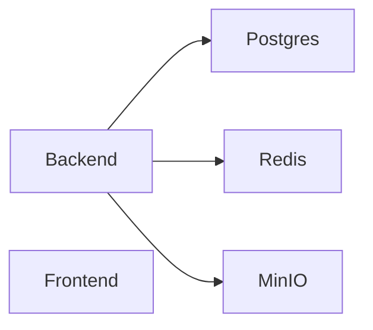
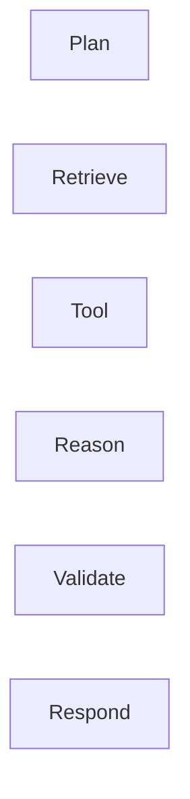

# IMPLEMENTATION_PLAN.md

# Business Copilot Platform Implementation Plan

---

# Purpose

This document converts all platform specifications into a concrete execution plan.

This is the primary document that Claude Code and Codex should follow while building the platform.

The goal is to avoid:

* Architecture drift
* Duplicate work
* Rewrites
* Premature optimization

and ensure all features are built in the correct dependency order.

---

# Development Principles

## Rule 1

Build foundations before features.

---

## Rule 2

Never build UI before APIs exist.

---

## Rule 3

Never build APIs before schemas exist.

---

## Rule 4

Never build Agent Runtime before Data Platform exists.

---

## Rule 5

Every phase must be deployable.

---

# High Level Build Order

```text
Phase 0  → Repository Foundation
Phase 1  → Infrastructure
Phase 2  → Database Foundation
Phase 3  → Authentication & RBAC
Phase 4  → Core Platform APIs
Phase 5  → Space Platform
Phase 6  → Connector Platform
Phase 7  → Knowledge Platform
Phase 8  → Semantic Layer
Phase 9  → Agent Platform
Phase 10 → Workflow Engine
Phase 11 → Chat Platform
Phase 12 → FinOps Platform
Phase 13 → Analytics Platform
Phase 14 → Governance Platform
Phase 15 → Marketplace
Phase 16 → Frontend Platform
Phase 17 → Observability
Phase 18 → Hardening
Phase 19 → Production Readiness
```

---

# PHASE 0

# Repository Foundation

Goal:

Establish project structure.

---

## Deliverables

Repository structure

```text
business-copilot/

backend/
frontend/
infra/
docs/
tests/
.claude/
```

---

## Setup

* UV
* Ruff
* Pytest
* MyPy
* Pre-commit

---

## Claude Skills

Create:

```text
.claude/skills/

architecture-review
backend-fastapi
postgres-sqlalchemy
alembic-migrations
celery-workflows
langgraph-agents
frontend-react
```

---

# Completion Criteria

Repository builds successfully.

---

# PHASE 1

# Infrastructure Foundation

Goal:

Local development stack.

---

## Deliverables

Docker Compose

Services:

* PostgreSQL
* Redis
* MinIO
* Backend
* Frontend

---

## Infrastructure Layout



---

## Deliverables

* docker-compose.yml
* .env templates
* local startup scripts

---

# Completion Criteria

Local stack launches with one command.

---

# PHASE 2

# Database Foundation

Goal:

Establish database architecture.

---

## Deliverables

SQLAlchemy setup

Alembic setup

Base models

---

## Implement

### Multi-Tenant

* organizations
* workspaces
* spaces

---

### Identity

* users
* roles
* permissions

---

### Audit

* audit_logs

---

## Alembic Requirements

Every table migration generated.

---

# Completion Criteria

Database can be recreated from migrations.

---

# PHASE 3

# Authentication & RBAC

Goal:

Secure access.

---

## Deliverables

JWT Authentication

RBAC

Permission engine

---

## APIs

```text
/auth/login
/auth/logout
/auth/me
```

---

## Features

* Login
* Refresh token
* Password reset
* User management

---

# Completion Criteria

Users authenticate and permissions enforced.

---

# PHASE 4

# Core Platform APIs

Goal:

Foundation services.

---

## Deliverables

CRUD Framework

Pagination

Filtering

Search

---

## Implement

* Organizations
* Workspaces
* Spaces

APIs

Repositories

Services

---

# Completion Criteria

Core platform entities manageable.

---

# PHASE 5

# Space Platform

Goal:

Isolation layer.

---

## Implement

Space CRUD

Membership

Permissions

Space Settings

---

## APIs

```text
/spaces
```

---

## Database

* spaces
* space_members

---

# Completion Criteria

Spaces fully functional.

---

# PHASE 6

# Connector Platform

Goal:

External data access.

---

## Build Connector SDK

BaseConnector

---

## First Connectors

* PostgreSQL
* Snowflake
* Salesforce
* REST API

---

## Celery Tasks

* Sync
* Metadata Discovery

---

## APIs

```text
/connectors
```

---

# Completion Criteria

Connector creation and sync functional.

---

# PHASE 7

# Knowledge Platform

Goal:

Document intelligence.

---

## Features

Upload

Chunking

Embeddings

Vector Search

---

## Build

Document Pipeline

```text
Upload
→ Extract
→ Chunk
→ Embed
→ Store
```

---

## Storage

MinIO

pgvector

---

# Completion Criteria

Documents searchable.

---

# PHASE 8

# Semantic Layer

Goal:

Business language abstraction.

---

## Build

Business Terms

Metrics

Semantic Models

Rule Engine

---

## APIs

```text
/business-terms

/metrics

/semantic
```

---

# Completion Criteria

Business terms resolve to data.

---

# PHASE 9

# Agent Platform

Goal:

Core product capability.

---

## Build

Agent Builder

Agent Runtime

Agent Memory

Agent Versioning

Agent Sharing

---

## LangGraph Components

Planner

Memory

Tool Router

Response Composer

---

## Agent Runtime Flow



---

## APIs

```text
/agents
/agent-executions
```

---

# Completion Criteria

Agents execute successfully.

---

# PHASE 10

# Workflow Engine

Goal:

Automation platform.

---

## Build

Workflow Builder

Workflow Runtime

Trigger Engine

Approval Engine

---

## Celery

Mandatory.

---

## Queues

workflow.high

workflow.medium

workflow.low

---

## APIs

```text
/workflows
```

---

# Completion Criteria

Workflows execute asynchronously.

---

# PHASE 11

# Chat Platform

Goal:

Unified conversational experience.

---

## Build

Conversations

Messages

History

Streaming Responses

---

## Integrations

Agents

Connectors

Knowledge

Semantic Layer

---

## APIs

```text
/conversations
```

---

# Completion Criteria

Chat can answer enterprise questions.

---

# PHASE 12

# FinOps Platform

Goal:

Cost transparency.

---

## Build

Cost Events

Budgets

Forecasts

Quota Engine

---

## Tracking

Agent Cost

Workflow Cost

Connector Cost

Storage Cost

---

## APIs

```text
/finops
```

---

# Completion Criteria

Cost visible everywhere.

---

# PHASE 13

# Analytics Platform

Goal:

Usage intelligence.

---

## Build

Usage Events

Aggregation Jobs

Analytics APIs

---

## Metrics

Agent Usage

Workflow Usage

Connector Usage

Adoption

---

## Celery Jobs

Nightly aggregation.

---

# Completion Criteria

Analytics dashboards populated.

---

# PHASE 14

# Governance Platform

Goal:

Enterprise readiness.

---

## Build

Audit Engine

Approval Engine

Compliance Engine

Classification Engine

---

## APIs

```text
/permissions
/audit-logs
/compliance
```

---

# Completion Criteria

Audit trail complete.

---

# PHASE 15

# Marketplace

Goal:

Agent sharing ecosystem.

---

## Build

Marketplace Catalog

Publishing

Ratings

Reviews

Certification

---

## APIs

```text
/marketplace
```

---

# Completion Criteria

Agents discoverable and installable.

---

# PHASE 16

# Frontend Platform

Goal:

Complete UI.

---

## Build Order

1. Layout
2. Authentication
3. Spaces
4. Connectors
5. Documents
6. Semantic Layer
7. Agents
8. Workflows
9. Analytics
10. FinOps
11. Governance
12. Marketplace

---

## Global Components

Chat

Notifications

Search

---

# Completion Criteria

End-to-end UI functional.

---

# PHASE 17

# Observability

Goal:

Production visibility.

---

## Build

OpenTelemetry

Prometheus

Grafana

Structured Logging

---

## Metrics

Latency

Errors

Costs

Queue Depth

---

# Completion Criteria

Operational visibility exists.

---

# PHASE 18

# Hardening

Goal:

Enterprise quality.

---

## Activities

Load Testing

Security Testing

Pen Testing

Performance Optimization

---

## Targets

API < 300ms

Chat < 10s

Workflow Reliability > 99%

---

# Completion Criteria

Performance targets met.

---

# PHASE 19

# Production Readiness

Goal:

Launch readiness.

---

## Deliverables

Backup Strategy

Disaster Recovery

Monitoring

Incident Management

Runbooks

---

## Documentation

Architecture

APIs

Operations

User Guides

---

# Completion Criteria

Platform deployable for production customers.

---

# Cross-Cutting Requirements

Every phase must include:

---

## Testing

Unit Tests

Integration Tests

API Tests

---

## Security

Permission Checks

Audit Events

Encryption

---

## Cost Tracking

Generate cost events.

---

## Logging

Structured logs.

---

## Metrics

Prometheus metrics.

---

# Claude Code Execution Strategy

For every feature:

1. Read CLAUDE.md
2. Read MASTER_SPEC.md
3. Read Relevant Specification
4. Generate Schema
5. Generate Models
6. Generate Services
7. Generate APIs
8. Generate Tests
9. Generate Documentation

Never skip steps.

---

# Definition of Done

A task is complete only if:

* Models exist
* Migrations exist
* APIs exist
* Tests exist
* Permissions exist
* Logging exists
* Metrics exist
* Documentation exists

---

# Estimated Build Breakdown

| Area               | Relative Effort |
| ------------------ | --------------- |
| Infrastructure     | 5%              |
| Database           | 10%             |
| Connectors         | 15%             |
| Knowledge Platform | 10%             |
| Semantic Layer     | 8%              |
| Agent Platform     | 20%             |
| Workflow Engine    | 10%             |
| FinOps             | 7%              |
| Analytics          | 5%              |
| Governance         | 5%              |
| Marketplace        | 5%              |

---

# Final Goal

Deliver a production-grade Enterprise AI Operating System where:

```text
Spaces
+ Agents
+ Connectors
+ Knowledge
+ Semantic Models
+ Workflows
+ FinOps
+ Governance

=

Business Copilot Platform
```

Every component should be independently scalable, observable, governed, and cost-aware.
