# SYSTEM_ARCHITECTURE.md

# Business Copilot Platform Architecture

---

# Purpose

This document defines the complete technical architecture for the Business Copilot Platform.

This architecture must support:

* Multi-tenancy
* Agentic workflows
* Enterprise data connectivity
* AI-powered analytics
* Workflow automation
* Cost tracking
* Governance
* Enterprise scale

---

# Architectural Principles

## Principle 1: API First

Everything must be exposed through APIs.

No direct service-to-database access outside owned boundaries.

---

## Principle 2: Event Driven

Long-running operations must execute asynchronously.

Examples:

* Agent execution
* Connector synchronization
* Report generation
* Cost aggregation
* Usage aggregation

---

## Principle 3: Multi-Tenant

Every resource belongs to:

Organization
→ Workspace
→ Space

Tenant isolation is mandatory.

---

## Principle 4: Stateless APIs

FastAPI services should remain stateless.

State belongs in:

* PostgreSQL
* Redis
* Object Storage
* Vector Store

---

## Principle 5: AI Native

The system should assume AI execution is a first-class capability.

All services should be designed around:

* Agents
* Workflows
* Memory
* Retrieval

---

# High-Level Architecture

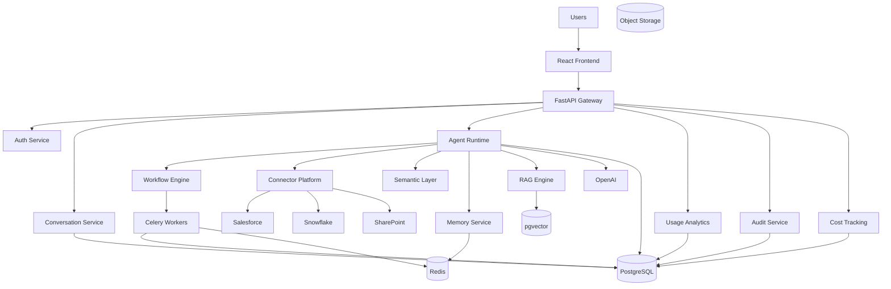

---

# Service Architecture

## Frontend Layer

Technology:

* React
* TypeScript
* Tailwind
* TanStack Query

Responsibilities:

* Chat UI
* Agent Builder
* Workflow Builder
* Dashboards
* Cost Tracking UI
* Administration

---

# API Gateway

Technology:

FastAPI

Responsibilities:

* Authentication
* Authorization
* Request validation
* Routing
* Rate limiting

No business logic should exist here.

---

# Authentication Service

Responsibilities:

* Login
* SSO
* OAuth
* JWT
* Session Management

Supported Providers:

* Google
* Microsoft
* Okta
* Azure AD

---

# Conversation Service

Responsibilities:

* Chat Sessions
* Message History
* Context Window Management
* Citations
* Follow-up Questions

Stores:

* Conversations
* Messages

---

# Agent Runtime Service

This is the heart of the platform.

Responsibilities:

* Agent Execution
* Planning
* Tool Calling
* Memory Retrieval
* Reflection
* Self Correction

---

# Agent Runtime Flow

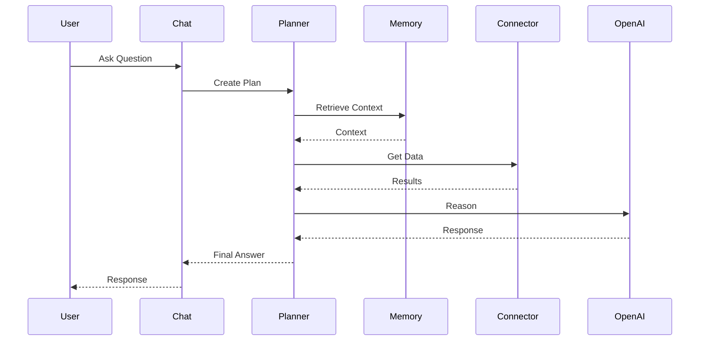

---

# Multi-Agent Architecture

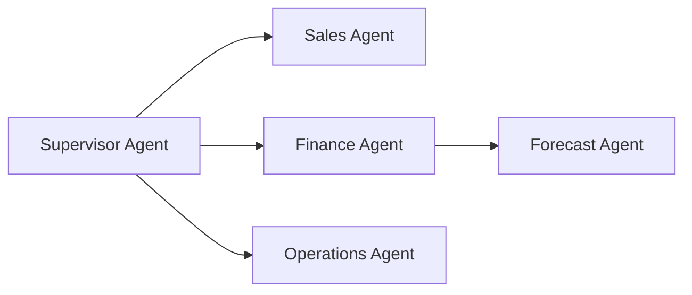

Capabilities:

* Delegation
* Specialist agents
* Task routing
* Aggregation

---

# Space Architecture

A Space is an isolated execution environment.

Contains:

* Agents
* Connectors
* Documents
* Semantic Models
* Workflows

---

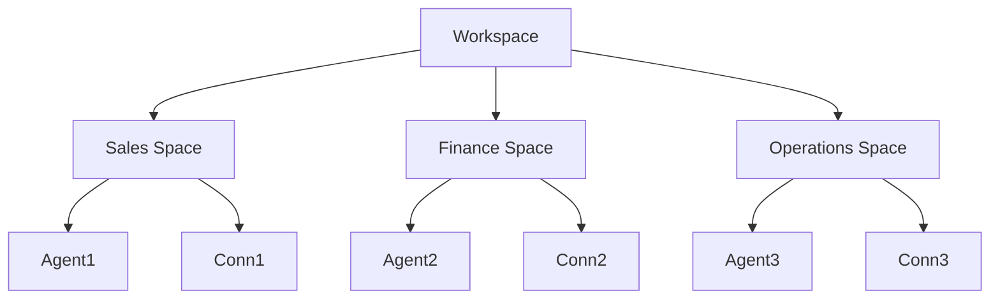

---

# Connector Platform

Responsibilities:

* Authentication
* Synchronization
* Metadata Discovery
* Query Execution

Supported Types:

## Databases

* PostgreSQL
* Snowflake
* BigQuery
* Redshift

## SaaS

* Salesforce
* HubSpot
* SAP

## Documents

* SharePoint
* Google Drive
* OneDrive

## APIs

* REST
* GraphQL

---

# Connector Execution Flow

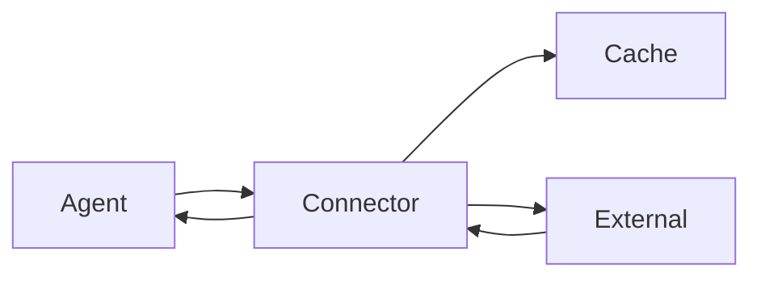

---

# Semantic Layer

Purpose:

Translate business language into data operations.

Example:

Revenue

↓

Net Sales - Returns

---

Components:

* Business Glossary
* KPI Definitions
* Semantic Mapping
* Metric Registry

---

# RAG Architecture

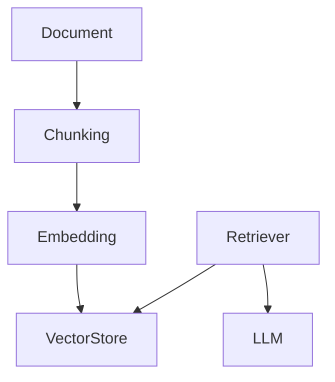

---

# Memory Architecture

Memory Types:

## Conversation Memory

Current chat session

---

## Agent Memory

Agent-specific knowledge

---

## Workspace Memory

Shared team memory

---

## Semantic Memory

Business definitions

---

# Workflow Engine

Responsibilities:

* Scheduling
* Automation
* Notifications
* Approvals

---

# Workflow Architecture

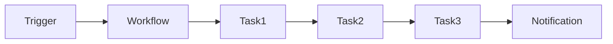

---

# Celery Architecture

Mandatory Component

Used For:

* Workflow Execution
* Agent Execution
* Connector Sync
* Cost Aggregation
* Usage Aggregation
* Report Generation
* Notifications

---

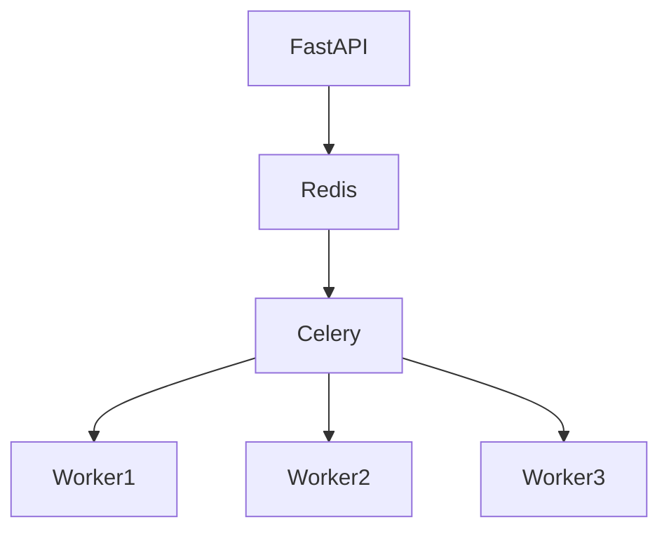

---

# Celery Queues

## High Priority

* Agent Execution

## Medium Priority

* Workflow Execution

## Low Priority

* Reports
* Analytics
* Cleanup

---

# Database Architecture

Primary Database:

PostgreSQL

---

Stores:

* Users
* Organizations
* Workspaces
* Spaces
* Agents
* Connectors
* Workflows
* Usage Events
* Cost Events

---

# Vector Database

Technology:

pgvector

Stores:

* Embeddings
* Semantic Models
* Knowledge Chunks

---

# Redis Architecture

Stores:

* Cache
* Session State
* Celery Broker
* Temporary Memory

---

# Object Storage

Stores:

* Documents
* PDFs
* Reports
* Exports
* Uploaded Files

Recommended:

* S3
* MinIO

---

# Usage Analytics Architecture

Track:

* Agent Runs
* User Activity
* Connector Calls
* Workflow Runs

---

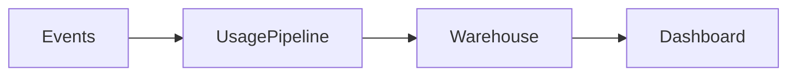

---

# FinOps Architecture

Track Costs By:

* Organization
* Workspace
* Space
* User
* Agent
* Workflow
* Connector

---

Cost Sources:

* LLM Calls
* Embeddings
* Storage
* Connector Calls
* Workflow Executions

---

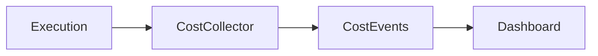

---

# Agent Analytics Architecture

Metrics:

* Usage
* Adoption
* Latency
* Errors
* Success Rate
* Cost

Generate:

* Weekly Reports
* Monthly Reports
* Quarterly Reports

---

# Governance Architecture

Components:

## RBAC

Permissions

## Audit

Activity Logging

## Compliance

Policies

## Data Security

Masking

Encryption

---

# Observability Architecture

Technology:

* OpenTelemetry
* Prometheus
* Grafana

---

Track:

* Latency
* Errors
* Queue Depth
* Token Usage
* Cost

---

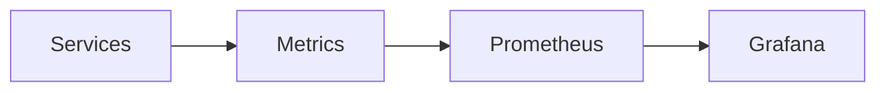

---

# Deployment Architecture

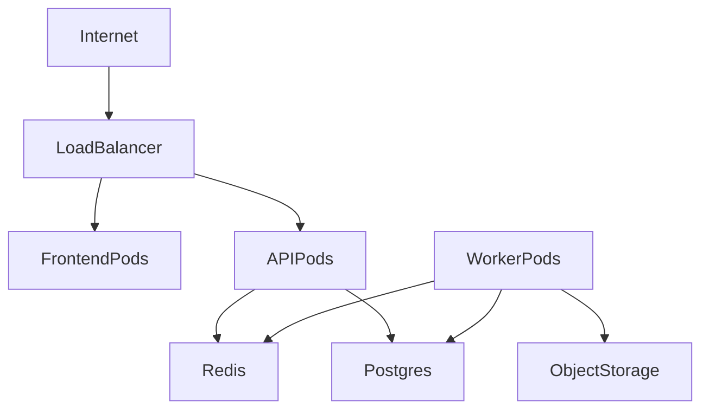

---

# Scalability Strategy

Scale Independently:

* API Pods
* Agent Workers
* Connector Workers
* Workflow Workers

Avoid monolithic scaling.

---

# Future Architecture

Planned:

* Multi-region
* Model routing
* Dedicated vector clusters
* Event bus
* Agent-to-agent communication protocol
* Enterprise marketplace

---

# Architecture Decisions

ADR-001

Use FastAPI

ADR-002

Use PostgreSQL + pgvector

ADR-003

Use Redis

ADR-004

Use Celery

ADR-005

Use Alembic

ADR-006

Use LangGraph

ADR-007

Use OpenAI Responses API

ADR-008

Use Space-based isolation

ADR-009

Use Agent Archival instead of Hard Deletion

ADR-010

Use FinOps as a first-class platform capability
