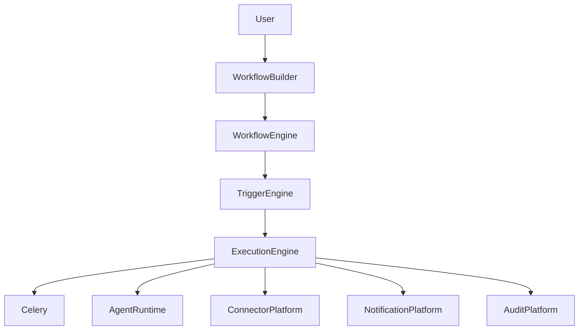
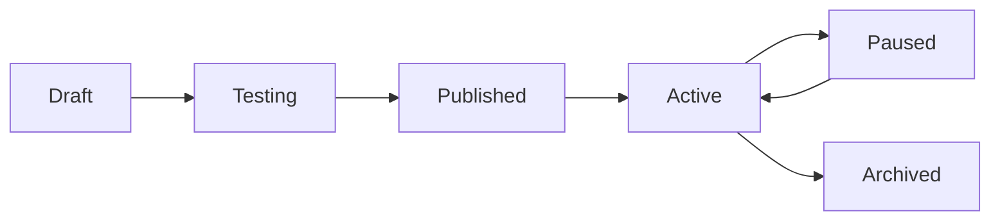
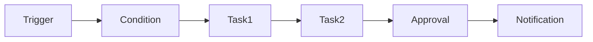
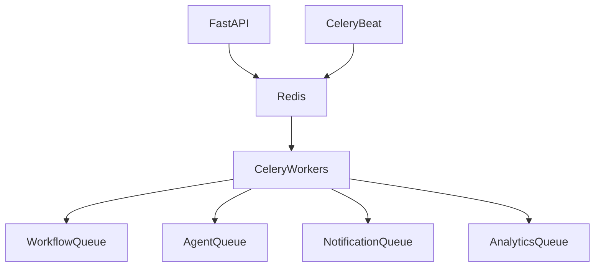
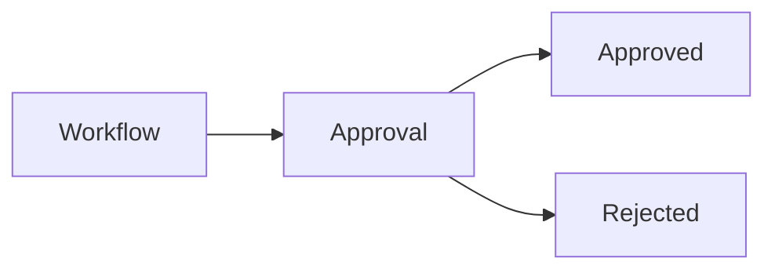
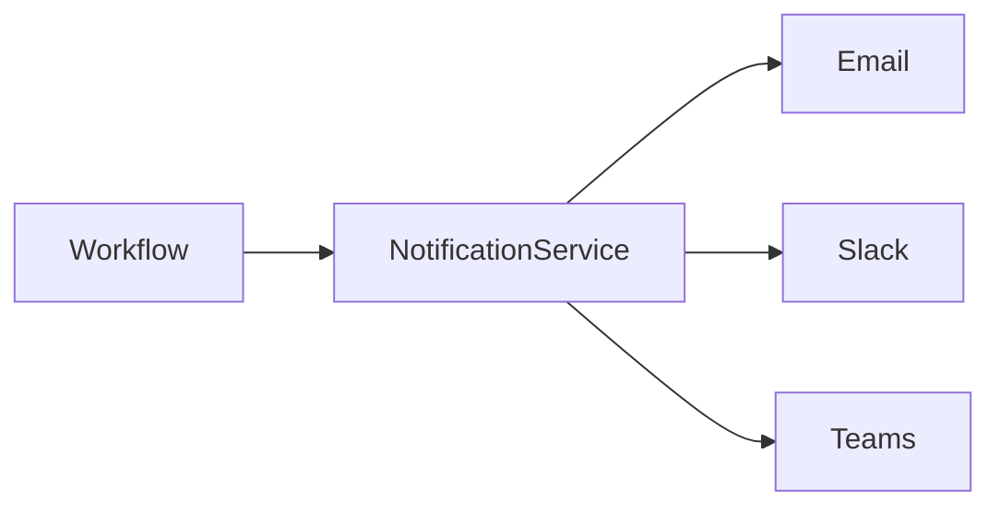
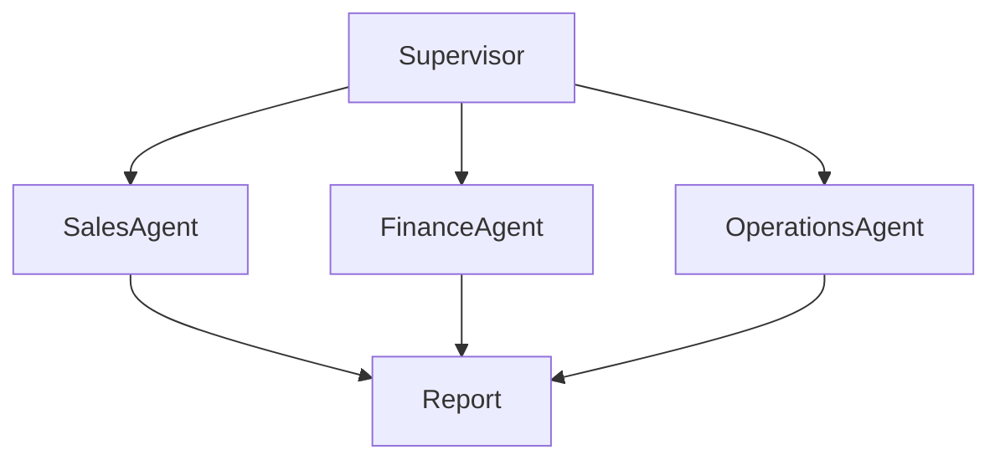

# WORKFLOW_ENGINE.md

# Workflow & Automation Platform Specification

---

# Purpose

The Workflow Engine is responsible for transforming insights into actions.

Without workflows, the platform behaves primarily as a conversational intelligence system.

With workflows, the platform becomes an operational AI platform capable of:

* Automation
* Monitoring
* Notifications
* Escalations
* Approvals
* Orchestration
* Scheduled Execution
* Event-Driven Execution

The Workflow Engine is the bridge between:

```text
Insight → Decision → Action
```

---

# Workflow Philosophy

Business users should not need:

* Python
* SQL
* BPMN
* Programming knowledge

Workflow creation should be:

* Visual
* No-Code
* Declarative

---

# Workflow Architecture



---

# Workflow Types

## Scheduled Workflows

Triggered on time-based schedules.

Examples:

* Daily Reports
* Weekly KPI Reviews
* Monthly Revenue Reports

---

## Event Driven Workflows

Triggered by events.

Examples:

* Salesforce Opportunity Created
* Ticket Escalated
* Data Sync Completed

---

## Agent Triggered Workflows

Triggered by agent decisions.

Examples:

* Revenue Drop Detected
* Inventory Threshold Breached
* Customer Churn Risk Identified

---

## Human Triggered Workflows

Triggered manually.

Examples:

* Generate Executive Report
* Refresh Semantic Models
* Rebuild Knowledge Base

---

## API Triggered Workflows

Triggered externally.

Examples:

* Webhooks
* REST APIs
* External Systems

---

# Workflow Lifecycle



---

# Workflow Builder

Users create workflows through a visual interface.

---

## Step 1

Workflow Metadata

Fields:

* Name
* Description
* Category
* Owner
* Space

---

## Step 2

Trigger Selection

Choose:

* Schedule
* Event
* Agent
* API
* Manual

---

## Step 3

Task Configuration

Define workflow steps.

---

## Step 4

Conditions

Define branching logic.

---

## Step 5

Notifications

Configure recipients.

---

## Step 6

Testing

Run simulation.

---

## Step 7

Publish

Activate workflow.

---

# Workflow Components

Every workflow consists of:

---

## Trigger

Starts execution.

---

## Conditions

Determine execution paths.

---

## Tasks

Perform work.

---

## Approvals

Require human confirmation.

---

## Notifications

Inform stakeholders.

---

## Audit Events

Track actions.

---

# Workflow Structure



---

# Trigger Engine

The Trigger Engine monitors execution conditions.

---

# Supported Trigger Types

## Cron

Examples:

```cron
0 8 * * *
```

Daily at 8 AM

---

## Event

Examples:

* Opportunity Created
* Data Updated
* Workflow Completed

---

## Threshold

Examples:

* Revenue < Target
* Inventory < Safety Stock

---

## Agent Output

Examples:

* Risk Score > 90
* Churn Probability > 80

---

## Webhook

External systems initiate execution.

---

# Celery Architecture

Celery is mandatory.

All long-running operations must execute through Celery.

---

# Celery Responsibilities

* Workflow Execution
* Report Generation
* Notifications
* Connector Synchronization
* Agent Execution
* Cost Aggregation
* Usage Aggregation
* Cleanup Tasks

---

# Celery Architecture



---

# Queue Design

## workflow.high

Business critical workflows.

Examples:

* Executive Alerts
* Security Incidents

---

## workflow.medium

Operational workflows.

Examples:

* KPI Reports
* Business Reviews

---

## workflow.low

Background processing.

Examples:

* Cleanup Jobs
* Maintenance Tasks

---

## analytics

Usage and aggregation jobs.

---

## notifications

Communication jobs.

---

# Workflow Tasks

Tasks are reusable execution units.

---

# Supported Task Types

## Agent Task

Execute an agent.

Example:

```text
Run Revenue Analyst Agent
```

---

## Connector Task

Query external systems.

Example:

```text
Query Snowflake
```

---

## Data Task

Transform data.

Example:

```text
Calculate Monthly Growth
```

---

## Notification Task

Send notifications.

Example:

```text
Send Slack Alert
```

---

## Approval Task

Require human review.

Example:

```text
Approve Budget Change
```

---

## Report Task

Generate documents.

Example:

```text
Create Weekly Executive Report
```

---

# Conditional Logic

Workflows support branching.

---

## If / Else

```text
IF Revenue < Target

THEN Alert Finance

ELSE Continue
```

---

## Multi Branch

```text
Low Risk

Medium Risk

High Risk
```

---

## Threshold Logic

```text
Inventory < 100
```

---

# Human In The Loop

Enterprise workflows often require approvals.

---

# Approval Workflow



---

# Approval Types

## Single Approver

One person.

---

## Multiple Approvers

Many users.

---

## Sequential Approvals

Approval chain.

---

## Majority Voting

Group approval.

---

# Notification Platform

Workflows can notify stakeholders.

---

# Channels

## Email

---

## Slack

---

## Microsoft Teams

---

## In-App

---

## Webhooks

---

# Notification Architecture



---

# Workflow Templates

Templates accelerate adoption.

---

## Sales Review Workflow

Weekly:

* Run Sales Agent
* Generate Report
* Notify Sales Team

---

## Finance Review Workflow

Monthly:

* Run Revenue Analysis
* Generate Variance Report
* Notify Finance

---

## Churn Monitoring Workflow

Daily:

* Evaluate Customers
* Detect Risks
* Notify Success Team

---

## Inventory Monitoring Workflow

Hourly:

* Check Inventory
* Create Alerts
* Notify Operations

---

# Agent Integration

Workflows can execute agents.

---

# Example

```text
Trigger

↓

Run Finance Agent

↓

Generate Insights

↓

Create Report

↓

Email CFO
```

---

# Multi-Agent Workflows

Workflows can orchestrate multiple agents.

---

# Example



---

# Space Integration

Every workflow belongs to a Space.

A workflow may access:

* Space Agents
* Space Connectors
* Space Documents
* Space Semantic Models

---

# Security Model

Workflow permissions inherit:

```text
Organization
 → Workspace
     → Space
         → Workflow
```

---

# Audit Logging

Every workflow action must create:

* Audit Event
* Usage Event
* Cost Event

---

# Workflow Analytics

Track:

* Execution Count
* Success Rate
* Failure Rate
* Duration
* User Adoption

---

# Workflow Health Score

Based on:

* Reliability
* Adoption
* Latency
* Error Rate

---

# Cost Tracking

Every workflow execution generates:

* LLM Costs
* Connector Costs
* Notification Costs
* Storage Costs

---

# Workflow Cost Formula

```text
Workflow Cost

=

Agent Cost

+

Connector Cost

+

Notification Cost

+

Storage Cost
```

---

# Failure Handling

Workflows must support:

* Retries
* Dead Letter Queues
* Partial Recovery
* Compensation Actions

---

# Retry Strategy

Example:

```text
Attempt 1

↓

Attempt 2

↓

Attempt 3

↓

Dead Letter Queue
```

---

# Workflow Versioning

Every modification creates a version.

Track:

* Author
* Timestamp
* Change Notes

---

# Rollback

Users may restore any prior version.

---

# Workflow Archival

States:

* Active
* Paused
* Archived

Deletion should be rare.

Archive preferred.

---

# Workflow Recommendations

The platform should suggest:

## Archive

Unused workflows.

---

## Optimize

Expensive workflows.

---

## Merge

Duplicate workflows.

---

# Future Enhancements

* Autonomous Workflows
* Workflow Learning
* Agent Teams
* Event Streaming
* BPMN Import
* Multi-Step Approval Chains
* Predictive Workflow Optimization

---

# Success Metrics

The Workflow Platform is successful when:

* Users automate business processes without coding.
* Agents can trigger meaningful actions.
* Human approvals remain governed.
* Workflows are reliable and observable.
* Costs remain transparent.
* Automation reduces manual effort across the organization.

The Workflow Engine is the execution backbone of the Business Copilot Platform, enabling the transition from intelligence to action.